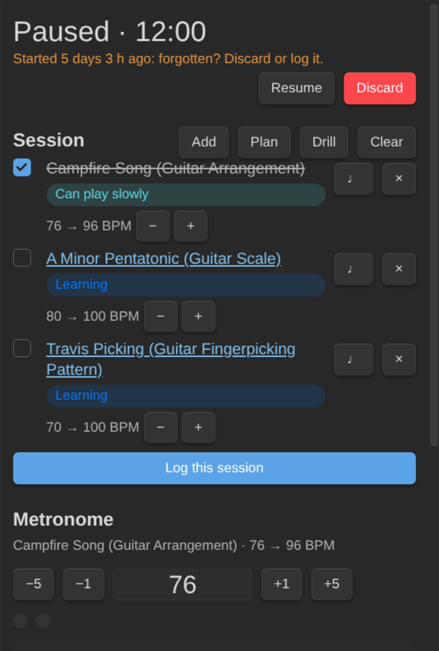
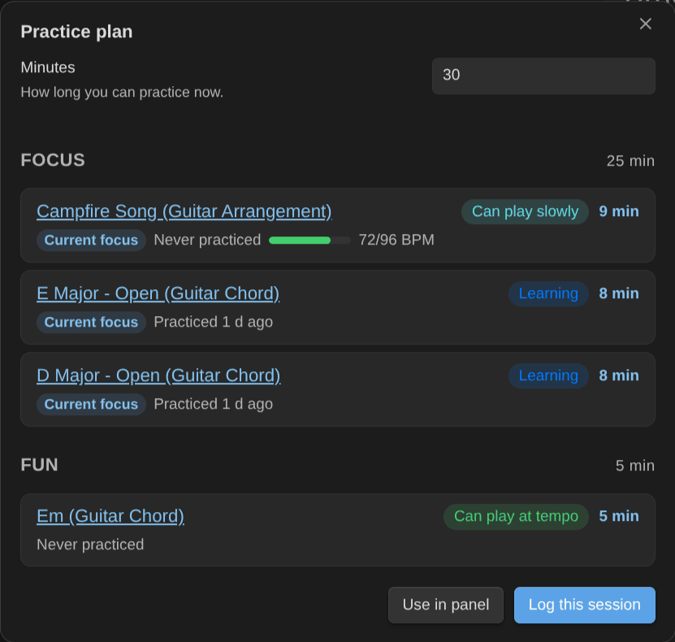
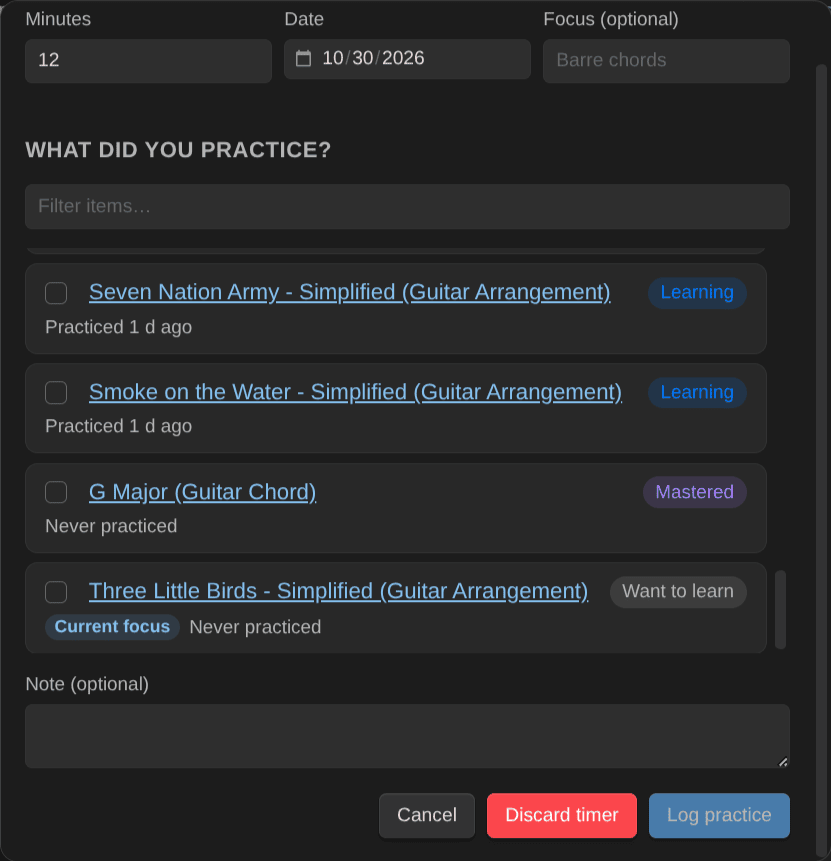
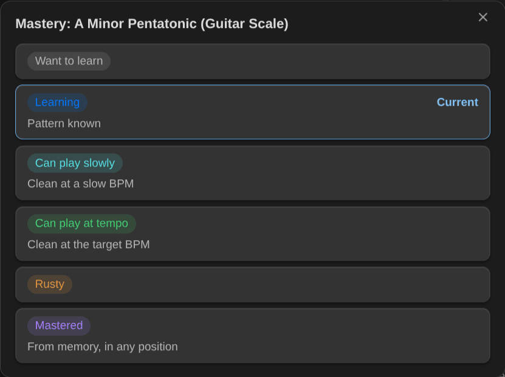
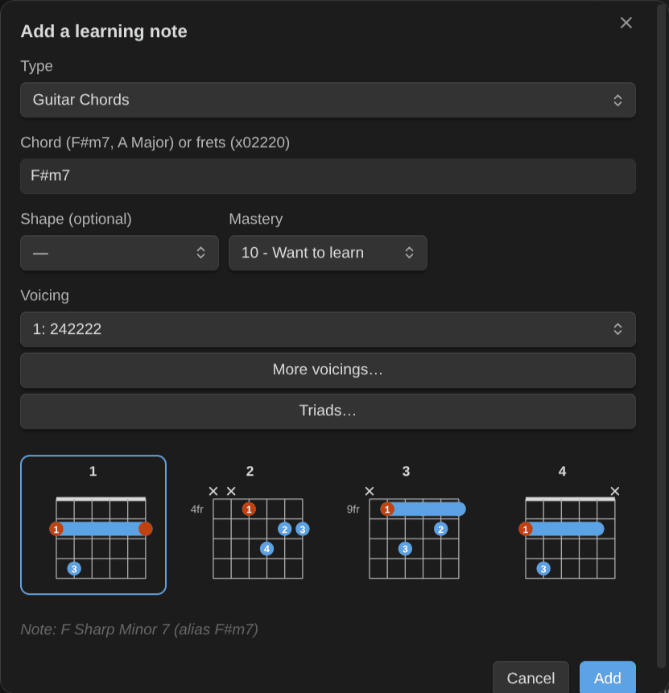
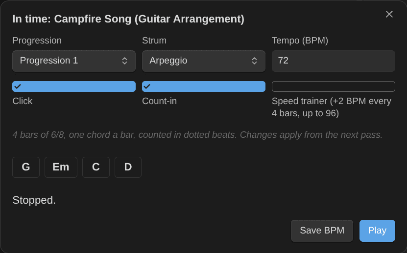
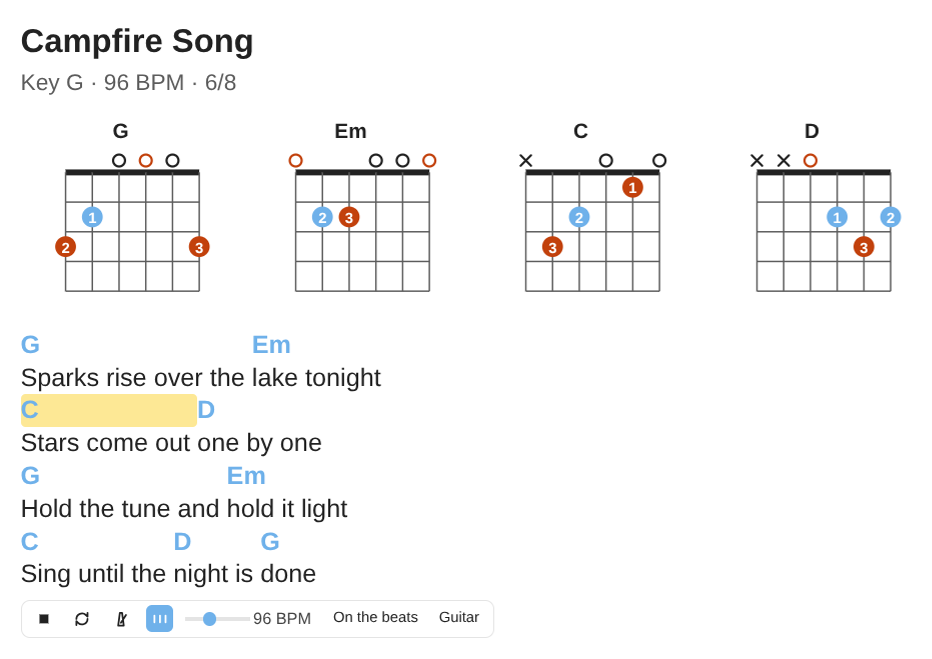
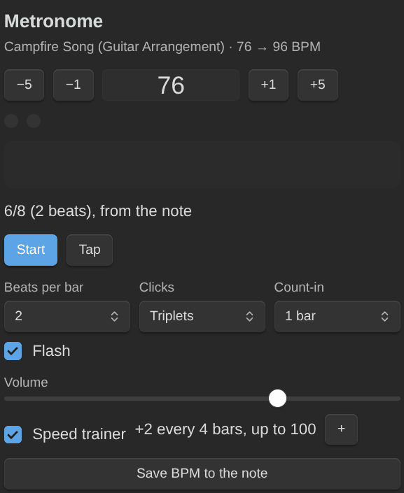
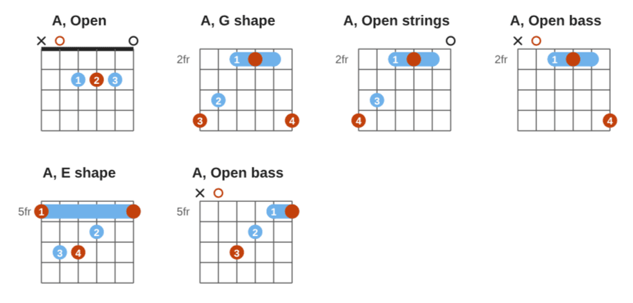
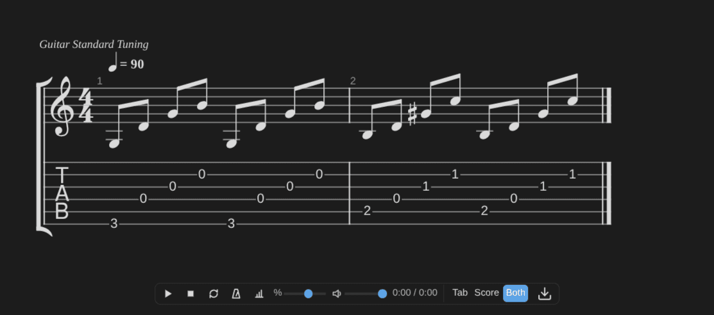

# Music Practice

An Obsidian plugin for learning an instrument in your notes: log practice in under a minute, run a practice timer, get a plan for the time you have, and let spaced review tell you what's slipping. Guitar and piano first, any instrument after.



Every chord, scale, technique, exercise and piece you learn is a note with a mastery level (Want to learn → Learning → Can play slowly → Can play at tempo → Rusty → Mastered). The plugin reads those notes, ranks what to practice next, plans your session, and writes back what you did: the session note, the items you practiced, your BPM, your review results and the time spent on the activity. Your notes stay plain Markdown with frontmatter; Obsidian Bases can show all of it.

I built this because I'm learning guitar and piano again, and I wanted my practice to live next to the rest of my notes, with a system that tells me what to work on next, instead of a pile of songs and exercises I never get back to.

What changed in each version is in the [changelog](./CHANGELOG.md). What's coming is in the [milestones](https://github.com/dsebastien/obsidian-music-practice/milestones) and [issues](https://github.com/dsebastien/obsidian-music-practice/issues).

## Screenshots

Plan a session for the time you have:



Log what you practiced, with the minutes from the timer, or discard a timer you forgot:



Change an item's mastery, with what each level means for it:



Add a chord from its symbol, and pick its voicing:



Practice a song's chords in time, as a backing loop with a click and the speed trainer:



A chord chart with its chord diagrams, lighting the chord that plays:



## Features

### Practice

- **Log practice**: record the minutes (or use the timer), the items you worked on, a quality rating, BPM and review results, and an optional note. One session note per practice, no duplicates. **Undo the last log**, from the notice or a command.
- **Practice timer** in the status bar, with pause. It comes back after a restart. A timer that started more than 4 hours ago shows as forgotten.
- **Discard a forgotten timer**: throw away a timer you forgot to stop, without logging it. It asks first and says how long the timer ran.
- **Practice plan**: "I have 30 minutes" gives a warm-up, a focus block, due reviews and something fun.
- **Practice next**: everything ranked by priority, staleness, BPM gap and what it unlocks.
- **Practice panel**: the timer, your session list from a plan, BPM nudges, the metronome, Log this session.
- **Metronome and speed trainer**: accents, subdivisions, tap tempo, a count-in and a beat flash, and the meter of the piece you practice. The speed trainer steps up to the note's target BPM, and Save BPM keeps the tempo you reached.
- **Practice a progression in time**: a song's chords, one a bar or as its chart's bar lines say, as a backing loop with a click, a count-in and the speed trainer, to practice the changes or to solo over them. Save BPM keeps the tempo you reached.
- **Play along with a recording**: a song's audio or video file of your vault, with an A-B loop, the speed from 50 % to 125 % without a pitch change, its sections to jump to or loop, and a count-in before each pass. Save BPM keeps the tempo you reached.
- **Chord change drills**: count the changes between two chords in a minute. Your best and last counts go on the pair's note.
- **Key, scales and hard changes of a piece**: find a song's key and the scales to solo with, and drill its hardest chord changes first.
- **Mastery and spaced review**: a rubric for each kind of item, and a light SM-2 review that catches what's getting rusty.
- **Skill tree**: prerequisites between items, so you see what's ready to learn.
- **Shortcuts from outside Obsidian**: Obsidian URIs start, stop or discard the timer, log, plan or pick what to practice next (phone shortcuts, Stream Deck, NFC tags).



### Chords, scales and voicings

- **Notation blocks**: ` ```chord ` (guitar diagrams, piano chords), ` ```keyboard `, ` ```fretboard `, ` ```chords ` (ChordPro charts, transposable, with their chord diagrams), ` ```strum ` (strumming patterns), ` ```picking ` (fingerpicking patterns), ` ```progression ` and ` ```circle ` (the circle of fifths), drawn by the [Music Notation](https://github.com/dsebastien/music-notation) library. Put several diagrams side by side (`---`), in any orientation, or left-handed. They work on Obsidian Publish too, through the library's loader.
- **Notes draw their own diagram**: an empty block in a chord, scale, arpeggio, strumming pattern or fingerpicking pattern note draws from the note's properties (chord, frets, fingers; scale root, type and shape; arpeggio notes their chord in its shape; strumming patterns their pattern, time signature, feel and tempo). Fingerpicking pattern notes draw their pattern, time signature, chord and tempo. They all draw on Publish too. Nothing is written twice.
- **Chords in words or frets**: `A Major`, `F Sharp Minor 7`, or `x02220` (the chord is recognized). **Identify this chord** names a chord note from its frets.
- **Click the notes**: no need to know `x32010`. Click the frets on a fretboard or the keys on a keyboard to enter a chord; it is named as you click, and when the notes make no chord, the chords that hold them show with the notes they miss.
- **All the ways to play a chord**: every playable voicing, easiest first, narrowed down by neck area and root string. Switch a chord note to one, or add it as its own note.
- **Triads** on string sets, as learning notes titled with their string set and inversion. An inversion comes after its root position.
- **Chord transitions**: the easiest way from one chord to the next, with the fingers that stay or slide marked, and tips. And the smoothest voicings for a whole progression.
- **Scales and modes**: positions (boxes, CAGED, 3NPS), characteristic notes, comparisons, every mode of a key. Arpeggios in their CAGED shapes, the scale that fits a song's chords, and a chord's notes over a scale.
- **Strumming patterns**: paste a pattern the way you find it on the web (`D DU UDU`), see it on a beat grid and hear it over its chords, straight or swung.
- **Fingerpicking patterns**: Travis, alternate bass, 1-2-3-4 or your own (`p i m a`), as learning notes with mastery and BPM, played in time over a chord or a progression.
- **Progressions and the circle of fifths**: write `I V vi IV` (or `1 5 6m 4`) once and see it in any key, with a diagram for each chord, and play it in time. Chord charts play in time too, bar by bar when you write bar lines. The circle shows a key's chords on the wheel; click one to hear it.
- **Capo and piano voicings**: a capo on any guitar chord or fretboard, with the chord it sounds. Piano chords in any inversion, shell or rootless, with both hands.



### Tabs, scores and sound

- **Tabs and scores** with playback: play, slow down, loop, metronome and count-in. Write them in alphaTex, or use a Guitar Pro / MusicXML file. Export to Guitar Pro 7 or MIDI, or print. Everything is bundled, so it works offline, and in popout windows too.
- **Tab exercises**: turn a scale position or an arpeggio shape into a tab that plays in time, with a count-in and a speed control. Save BPM in the tab's player bar keeps the tempo you reached.
- **Hear the diagrams**: click a chord, keyboard or fretboard diagram to hear it, or a dot to hear one note. One bar under each block plays its diagrams, one by one or all in turn. Chords strum, scales go up and down. Each note lights up on the drawing as you hear it.
- **Imports**: Guitar Pro, MusicXML, Capella and ChordPro files, plus pasted text tabs (drum tabs too) and chord sheets. A text tab already in a note shows as tablature you can play, and **Edit as alphaTex** turns it into alphaTex. **Tab**, **Score** and **Both** in the player bar change the view.



### Your notes, your rules

- **Works with the [Obsidian Starter Kit](https://store.dsebastien.net/)** (note types, folders, templates and statuses come from it) or on its own: tag your notes `type/music/guitar/chord` and give them a mastery level.
- **Every rule is a setting**: mastery levels, review intervals, score weights, plan blocks, the rubric, property names, playback. It installs with sensible defaults.
- **Commands for everything**, and a **public API** so scripts and AI assistants can log and plan practice with the same rules.

## Documentation

The user guide lives at **https://dsebastien.github.io/obsidian-music-practice/** and grows with each release.

## Installation

- From Obsidian: **Settings → Community plugins → Browse**, search for "Music Practice", then **Install** and **Enable**.
- Or from the community directory: https://community.obsidian.md/plugins/music-practice

Then follow the [getting started guide](https://dsebastien.github.io/obsidian-music-practice/usage.html).

## Development

Built with Bun and TypeScript from my [Obsidian plugin template](https://github.com/dsebastien/obsidian-plugin-template). See [DEVELOPMENT.md](./DEVELOPMENT.md) and [CONTRIBUTING.md](./CONTRIBUTING.md); the rules the plugin implements are in [documentation/Business Rules.md](./documentation/Business%20Rules.md).

## License

MIT License, see [LICENSE](./LICENSE).

The plugin embeds, unmodified: [alphaTab](https://github.com/CoderLine/alphaTab) (MPL-2.0), the [Bravura](https://github.com/steinbergmedia/bravura) music font (SIL Open Font License 1.1) and the SONiVOX soundfont shipped with alphaTab (Apache-2.0). Their notices and license texts are at the end of `main.js`.

<!-- support-cta -->

## News & support

To stay up to date about this plugin, Obsidian in general, personal knowledge management and note-taking:

- Subscribe to [my newsletter](https://dsebastien.net/newsletter)
- Subscribe to [my YouTube channel](https://youtube.com/@dsebastien)
- Join the [Knowii community](https://www.store.dsebastien.net/product/knowii-community/) and learn to organize your notes and put your knowledge to work, together with fellow knowledge workers

If this plugin is useful to you, here are the best ways to support my work ❤️:

- [Join the Knowii community](https://www.store.dsebastien.net/product/knowii-community/)
- [Become a GitHub Sponsor](https://github.com/sponsors/dsebastien)
- [Buy me a coffee](https://www.buymeacoffee.com/dsebastien)
- [Subscribe to my YouTube channel](https://youtube.com/@dsebastien)
- [Check out my products](https://store.dsebastien.net)

Found a bug or have an idea? [Open an issue](https://github.com/dsebastien/obsidian-music-practice/issues).
