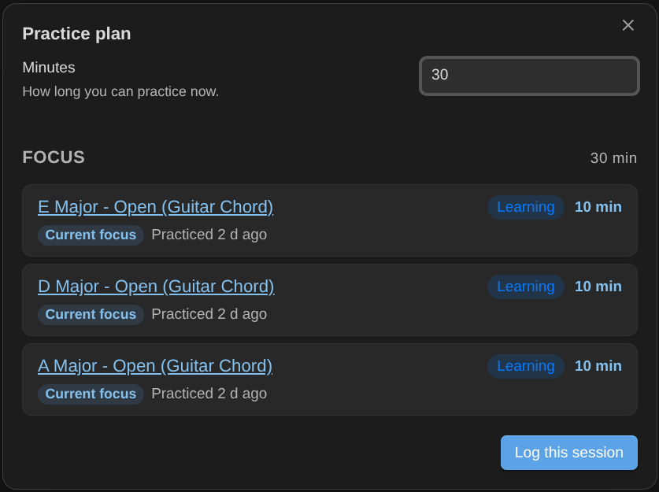
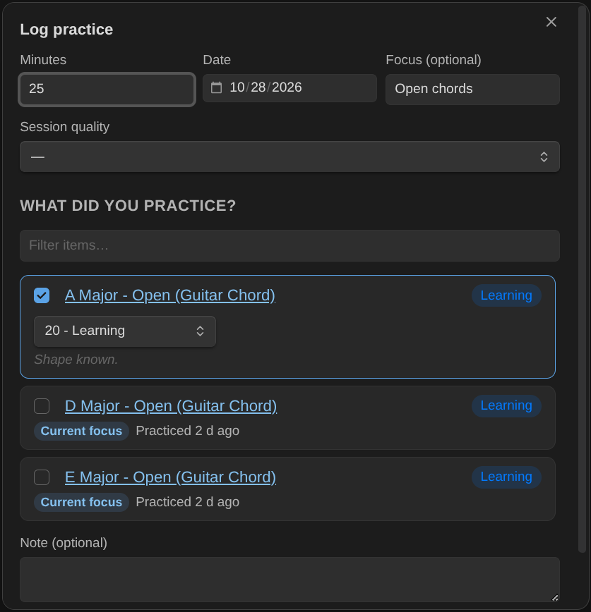
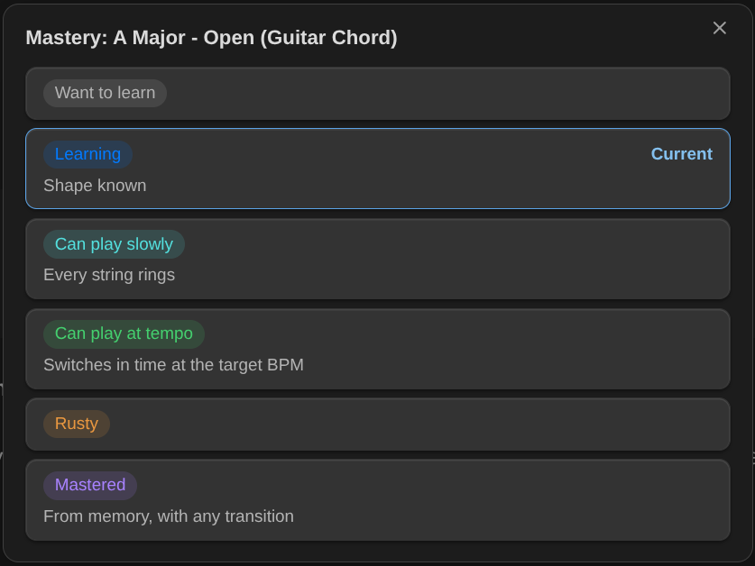
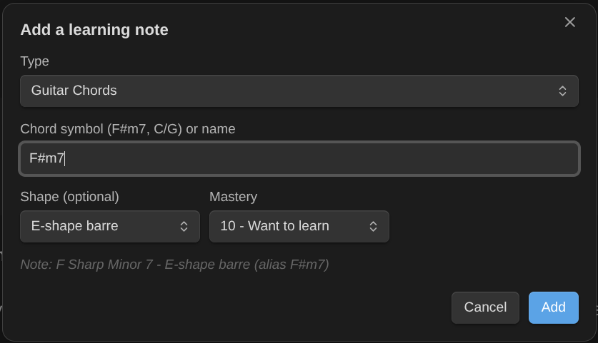
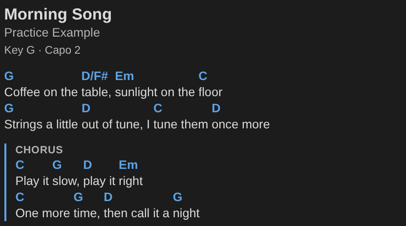
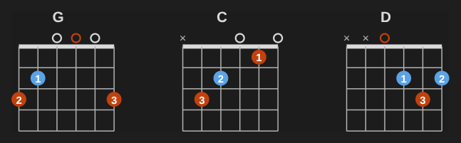
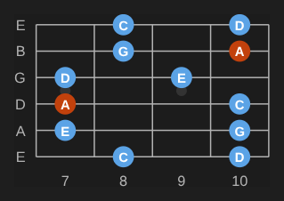
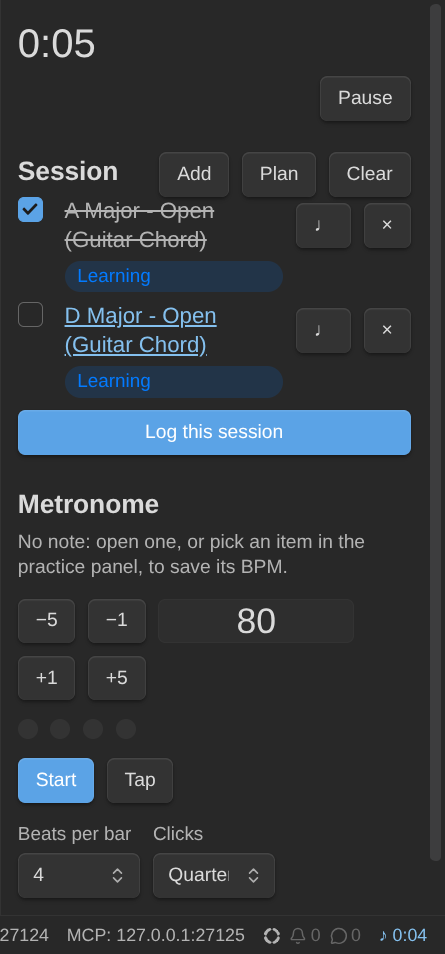

# Music Practice

An Obsidian plugin for learning an instrument in your notes: log practice in under a minute, run a practice timer, get a plan for the time you have, and let spaced review tell you what's slipping. Guitar and piano first, any instrument after.

Every chord, scale, technique, exercise and piece you learn is a note with a mastery level (Want to learn → Learning → Can play slowly → Can play at tempo → Rusty → Mastered). The plugin reads those notes, ranks what to practice next, plans your session, and writes back what you did: the session note, the items you practiced, your BPM, your review results and the time spent on the activity. Your notes stay plain Markdown with frontmatter; Obsidian Bases can show all of it.

I built this because I'm learning guitar and piano again, and I wanted my practice to live next to the rest of my notes, with a system that tells me what to work on instead of a pile of tabs.

> **Version 0.5** ships the practice panel, a metronome, chord change drills and undo, on top of the practice engine and notation blocks (chord diagrams, keyboards, fretboards, chord charts) that chord and scale notes draw from their own properties. Tabs and scores with playback come in 0.6. Follow progress in the [milestones](https://github.com/dsebastien/obsidian-music-practice/milestones) and [issues](https://github.com/dsebastien/obsidian-music-practice/issues).

## Screenshots

Plan a session for the time you have:



Log what you practiced, with each item's mastery, BPM and review:



Change an item's mastery, with what each level means for it:



Add a chord from its symbol:



## Features

### 0.1: practice engine (available)

- **Log practice**: minutes (or the timer), the items you worked on, a quality rating, BPM and review results, an optional note. One session note per practice, no duplicates.
- **Practice timer** in the status bar, recovered after a restart.
- **Practice plan**: "I have 30 minutes" gives a warm-up, a focus block, due reviews and something fun.
- **Practice next**: everything ranked by priority, staleness, BPM gap and what it unlocks.
- **Mastery and spaced review**: a rubric per kind of item, a light SM-2 review that catches what's getting rusty.
- **Skill tree**: prerequisites between items; see what's ready to learn.
- **Works with the [Obsidian Starter Kit](https://store.dsebastien.net/)** (note types, folders, templates and statuses come from it) or on its own: tag your notes `type/music/guitar/chord` and give them a mastery level.
- **Every rule is a setting**: mastery levels, review intervals, score weights, plan blocks, the rubric, property names. Sensible defaults on install.
- **Public API** so scripts and AI assistants can log and plan practice with the same rules.

### 0.2: notation (available)

- **Notation blocks**: ` ```chord ` (guitar diagrams, piano chords), ` ```keyboard `, ` ```fretboard ` and ` ```chords ` (ChordPro charts, transposable), drawn by the [Music Notation](https://github.com/dsebastien/music-notation) library. On Obsidian Publish through the library's loader.
- **New chord notes** get a voicing (frets, fingers and a diagram) picked from the built-in database (about 1,800 voicings).



### 0.3: layout (available)

- **Several diagrams in one block**, separated by `---`: a song's chords or a scale's positions side by side, or in a grid.
- **Orientation**: guitar chords sideways, fretboards standing up, keyboards with low notes at the bottom. **Left-handed** diagrams. Defaults for both in the settings.
- **Add a learning note** shows the top voicings of a guitar chord side by side: click one to pick it.



### 0.4: chords and scales (available)

- **Notes draw their own diagram**: an empty block in a chord or scale note draws from the note's properties (chord, frets, fingers; scale root, type and shape), in Obsidian and on Publish. Nothing is written twice.
- **Chords in words or frets**: `A Major`, `F Sharp Minor 7`, or `x02220` (recognized). **Identify this chord** names a chord note from its frets.
- **Scales and modes**: positions (boxes, CAGED, 3NPS), characteristic notes, comparisons, every mode of a key. **Add a learning note** picks a scale's root, type and shape, with a preview.



### 0.5: practice (available)

- **Practice panel**: the timer (with pause), your session list from a plan, BPM nudges, the metronome, Log this session.
- **Metronome and speed trainer**: accents, subdivisions, tap tempo; steps up to the note's target BPM; Save BPM.
- **Chord change drills**: count the changes between two chords in a minute; best and last on the pair's note.
- **Undo the last log**, from the notice or a command.



### 0.6: tabs, scores and playback (planned)

- Tabs and scores (alphaTex, via [alphaTab](https://alphatab.net)) with playback: play, slow down, loop, metronome.
- Play chords, scales and notes from the notation blocks.
- Import from Guitar Pro, MusicXML and plain-text tabs.

## Documentation

The user guide lives at **https://dsebastien.github.io/obsidian-music-practice/** and grows with each release.

## Installation

- From Obsidian: **Settings → Community plugins → Browse**, search for "Music Practice", then **Install** and **Enable**.
- Or from the community directory: https://community.obsidian.md/plugins/music-practice

Then follow the [getting started guide](https://dsebastien.github.io/obsidian-music-practice/usage.html).

## Development

Built with Bun and TypeScript from my [Obsidian plugin template](https://github.com/dsebastien/obsidian-plugin-template). See [DEVELOPMENT.md](./DEVELOPMENT.md) and [CONTRIBUTING.md](./CONTRIBUTING.md); the rules the plugin implements are in [documentation/Business Rules.md](./documentation/Business%20Rules.md).

## License

MIT License, see [LICENSE](./LICENSE).

<!-- support-cta -->

## News & support

To stay up to date about this plugin, Obsidian in general, personal knowledge management and note-taking:

- Subscribe to [my newsletter](https://dsebastien.net/newsletter)
- Subscribe to [my YouTube channel](https://youtube.com/@dsebastien)
- Join the [Knowii community](https://www.store.dsebastien.net/product/knowii-community/) and learn to organize your notes and put your knowledge to work, together with fellow knowledge workers

If this plugin is useful to you, here are the best ways to support my work ❤️:

- [Join the Knowii community](https://www.store.dsebastien.net/product/knowii-community/)
- [Become a GitHub Sponsor](https://github.com/sponsors/dsebastien)
- [Buy me a coffee](https://www.buymeacoffee.com/dsebastien)
- [Subscribe to my YouTube channel](https://youtube.com/@dsebastien)
- [Check out my products](https://store.dsebastien.net)

Found a bug or have an idea? [Open an issue](https://github.com/dsebastien/obsidian-music-practice/issues).
