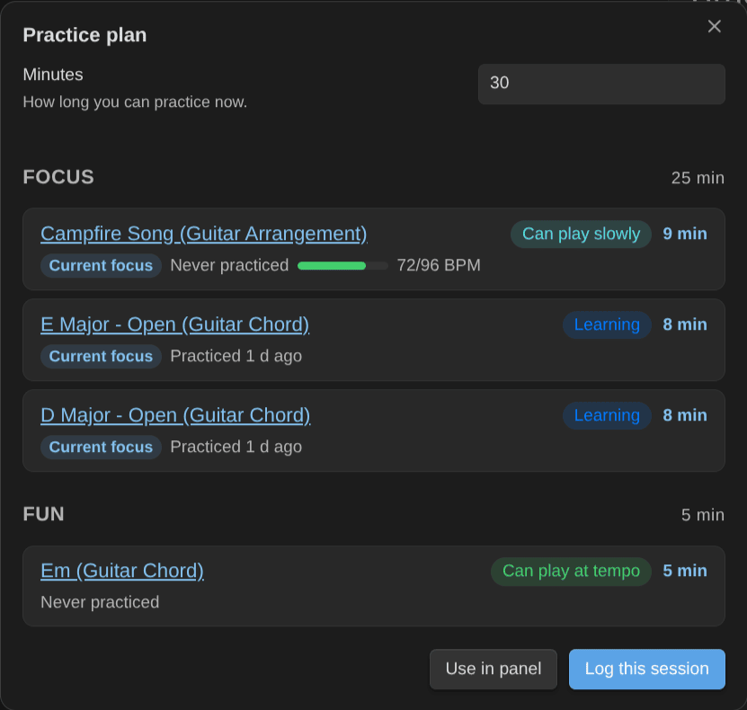

# Music Practice

Learn an instrument in Obsidian: log practice in under a minute, run a practice timer, get a plan for the time you have, and let spaced review tell you what's slipping. Guitar and piano first, any instrument after.

> Version 0.12: the practice engine, a practice panel, a metronome with a count-in and a speed trainer, chord change drills, a song's key and hardest changes, progressions you practice in time, tab exercises, every way to play a chord, triads, chord transitions, tabs and scores with playback, imports, and notation blocks (chord diagrams, keyboards, fretboards, chord charts, strumming and picking patterns, progressions, the circle of fifths). Chord, scale, arpeggio, strumming pattern and fingerpicking pattern notes draw their own diagram from their properties. Every diagram plays, and its notes light up as you hear them.

## Key features

- Log practice: minutes or the timer, items practiced, quality, BPM, review results.
- Practice timer in the status bar, with pause. Discard a timer you forgot.
- Practice plan for N minutes: warm-up, focus, review, fun.
- Practice next: everything ranked by priority, staleness, BPM gap and unlocks.
- Mastery levels with a rubric, and a light spaced-review system.
- A [practice panel](usage.md#practice-panel) with your session list and a [metronome](usage.md#metronome): count-in, beat flash, speed trainer, and the time signature of the piece.
- [Chord change drills](usage.md#chord-change-drills), and the [key and scales of a piece](usage.md#key-and-scales-of-a-piece).
- [Progressions in time](usage.md#progressions-in-time): a song's chords as a backing loop, and [tab exercises](usage.md#tab-exercises) of your scales and arpeggios.
- [Shortcuts from outside Obsidian](usage.md#shortcuts-from-outside-obsidian): start the timer, log or plan from a phone, a Stream Deck or an NFC tag.
- Works with the Obsidian Starter Kit, or on its own.
- Every rule is a setting, with sensible defaults.
- [All the ways to play a chord](usage.md#all-the-ways-to-play-a-chord), easiest first, by neck area and root string.
- [Triads](usage.md#triads) and [chord transitions](usage.md#chord-transitions).
- [Tabs and scores](notation.md#tabs-and-scores) with playback, and [imports](usage.md#imports).
- [Notation blocks](notation.md): chord diagrams, keyboards, fretboards and chord charts from plain text, side by side, vertical or horizontal, left-handed.
- [Strumming patterns](notation.md#strumming-patterns) and [picking patterns](notation.md#picking-patterns) you can hear, [progressions](notation.md#progressions) in any key, and the [circle of fifths](notation.md#circle-of-fifths).
- A capo, arpeggios, piano voicings and the scale that fits a song's chords ([Chords and scales, easier](notation.md#chords-and-scales-easier)).

## Install

In Obsidian, open **Settings → Community plugins → Browse**, search for "Music Practice", then **Install** and **Enable**. The listing is also on the [community directory](https://community.obsidian.md/plugins/music-practice). Then follow [Usage](usage.md).

## How it works

Each thing you learn (a chord voicing, a scale, a technique, an exercise, an arrangement of a piece) is a note with a mastery level:

| Level | Meaning           |
| ----- | ----------------- |
| 10    | Want to learn     |
| 20    | Learning          |
| 30    | Can play slowly   |
| 40    | Can play at tempo |
| 50    | Rusty             |
| 60    | Mastered          |

The plugin reads those notes, ranks what to practice, plans sessions, and writes back what you practiced. The exact rules are listed in [Rules](rules.md).

## About

Created by [Sébastien Dubois](https://dsebastien.net).

<!-- support-cta -->

## News & support

To stay up to date about this plugin, Obsidian in general, personal knowledge management and note-taking:

- Subscribe to [my newsletter](https://dsebastien.net/newsletter)
- Subscribe to [my YouTube channel](https://youtube.com/@dsebastien)
- Join the [Knowii community](https://www.store.dsebastien.net/product/knowii-community/) and learn to organize your notes and put your knowledge to work, together with fellow knowledge workers

If this plugin is useful to you, here are the best ways to support my work ❤️:

- [Join the Knowii community](https://www.store.dsebastien.net/product/knowii-community/)
- [Become a GitHub Sponsor](https://github.com/sponsors/dsebastien)
- [Buy me a coffee](https://www.buymeacoffee.com/dsebastien)
- [Subscribe to my YouTube channel](https://youtube.com/@dsebastien)
- [Check out my products](https://store.dsebastien.net)
