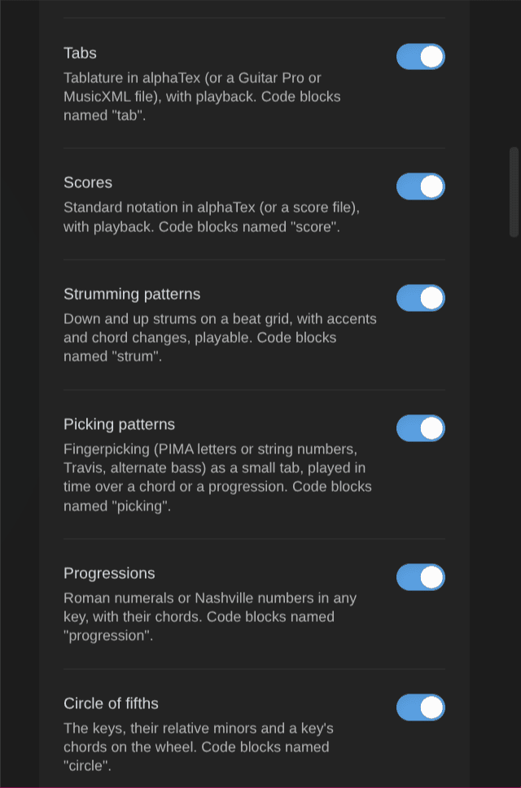

# Configuration

Every rule the plugin applies is a setting, with defaults that work on install. Open **Settings → Music Practice**.

## Main settings

| Setting                      | Default         | What it does                                                                                                                                                                |
| ---------------------------- | --------------- | --------------------------------------------------------------------------------------------------------------------------------------------------------------------------- |
| Note types                   | (information)   | Where the note types come from: the Obsidian Starter Kit, or the standalone note model.                                                                                     |
| Default practice plan length | 30              | Minutes offered when you plan a session.                                                                                                                                    |
| Session notes heading        | Notes           | Section of the session note that receives a log's note.                                                                                                                     |
| Activity name                | Learn {subject} | The name Log practice proposes for a new activity. Without the Starter Kit and `session_types`: the activity your sessions count towards when no earlier session links one. |

## Notation blocks

One switch per kind of [notation block](notation.md), all on by default: **Chord diagrams** (` ```chord `), **Chord charts** (` ```chords `), **Keyboards**, **Fretboards**, **Tabs** (` ```tab `), **Scores** (` ```score `), **Strumming patterns** (` ```strum `), **Picking patterns** (` ```picking `), **Progressions** (` ```progression `) and **Circle of fifths** (` ```circle `). A block turned off shows as code. Reload the plugin to let another plugin draw it. The status line says when another plugin already draws one of them.



| Setting                   | Default    | What it does                                                                                           |
| ------------------------- | ---------- | ------------------------------------------------------------------------------------------------------ |
| Left-handed               | Off        | Mirrors guitar chord diagrams and fretboards (the low string on the right). Keyboards don't change.    |
| Chord diagram orientation | Vertical   | Vertical: the nut on top. Horizontal: the strings across, the high string on top, as in tabs.          |
| Fretboard orientation     | Horizontal | Horizontal: the high string on top. Vertical: the nut on top, as a chord diagram.                      |
| Keyboard orientation      | Horizontal | Horizontal: low notes on the left. Vertical: low notes at the bottom. Piano chords follow it.          |
| Note names                | Letters    | How diagrams and drills name notes: letters (C D E), solfège (Do Ré Mi) or German (H for B, B for B♭). |

A block's own `orientation:`, `hand:` or `naming:` wins over these. Diagrams on screen redraw when you change them (reading view, live preview, embeds).

**Note names** only changes how names show: the titles, dots, keys and string names of the diagrams, the chord charts and progressions, and the drills' questions, answers and weak-spot maps. Blocks are read as you wrote them, so a note written in letters stays right whatever you pick. Note titles, properties and drill notes keep letters. The hints in Add a learning note, Identify this chord and Voicings of a chord stay in letters too, and so do tabs and scores. On Obsidian Publish, see [Notation](notation.md#obsidian-publish).

## Playback

| Setting           | Default   | What it does                                                                                                                                                                                                                                                        |
| ----------------- | --------- | ------------------------------------------------------------------------------------------------------------------------------------------------------------------------------------------------------------------------------------------------------------------- |
| Play the diagrams | On        | A click on a chord, keyboard or fretboard diagram plays it, with one bar under each block, and a bar under strumming and picking patterns. Progressions and chord charts get a bar that plays them in time. A click on the circle of fifths plays a key or a chord. |
| Sound             | Soundfont | Soundfont: recorded instruments, the same as tabs and scores. Light synthesizer: a small computed sound, as on Obsidian Publish.                                                                                                                                    |
| Volume            | 80        | From 0 to 100. The volume of every play bar (the bars have no volume control).                                                                                                                                                                                      |
| Scale tempo       | 90        | Notes per minute when a scale plays, from 20 to 240.                                                                                                                                                                                                                |
| Strum             | 12        | Milliseconds between two strings when a chord is strummed, from 0 to 200.                                                                                                                                                                                           |

Each diagram's bar can change the speed, volume and sound for that diagram.

## Metronome

| Setting                            | Default       | What it does                                                                                                               |
| ---------------------------------- | ------------- | -------------------------------------------------------------------------------------------------------------------------- |
| Beats per bar                      | 4             | From 2 to 12; the first is accented.                                                                                       |
| Clicks                             | Quarter notes | Per beat: quarter notes, eighths, triplets, sixteenths.                                                                    |
| Volume                             | 0.7           | From 0 to 1.                                                                                                               |
| Speed trainer step                 | 2             | BPM added at each step.                                                                                                    |
| Speed trainer bars                 | 4             | Bars between two steps.                                                                                                    |
| Count-in                           | 1             | Bars of clicks before the first bar, from 0 (none) to 4. With it on, a chord change drill counts 3, 2, 1 before it starts. |
| Flash on each beat                 | Off           | A light that flashes on each beat, beat one in another color: for noisy rooms.                                             |
| Chord change drill length          | 60            | Seconds, from 10 to 600.                                                                                                   |
| Questions per drill                | 20            | Note, chord and scale drills: questions in one drill, from 1 to 100.                                                       |
| Weak spots share                   | 60            | Percent of the questions about your weak spots, from 0 to 100.                                                             |
| Right answers to clear a weak spot | 3             | Right answers in a row, each faster than the fast answer, from 1 to 10.                                                    |
| Fast answer                        | 2             | Seconds, from 0.5 to 10.                                                                                                   |

## Play-along

| Setting           | Default | What it does                                                                                                              |
| ----------------- | ------- | ------------------------------------------------------------------------------------------------------------------------- |
| Play-along player | On      | Draws ` ```playalong ` blocks (a recording with an A-B loop, speed, sections and a count-in). Off: they show as code.     |
| Pre-roll          | 0.2     | Seconds played before A at each pass of the loop, from 0 to 2, so the first note isn't cut. The count-in still ends on A. |

The count-in uses the metronome's **Count-in** bars (one at least) and its **Volume**.

## Rules

| Group          | Settings (defaults)                                                                                                                                                                                                                 |
| -------------- | ----------------------------------------------------------------------------------------------------------------------------------------------------------------------------------------------------------------------------------- |
| Mastery levels | Want to learn 10, Learning 20, Can play slowly 30, Can play at tempo 40, Rusty 50, Mastered 60. Must increase.                                                                                                                      |
| Spaced review  | First interval 3 days, maximum 90 days, good review × 2, due-soon window min(3 days, interval / 3).                                                                                                                                 |
| Practice score | Priority base 70 minus the priority number (25 points when the priority is missing or TBD, 99), staleness (never practiced 30; capped at 30 days, or 3 × 10 with an interval), BPM gap / 5, 3 points per unlock (max 5), Rusty +10. |
| Practice plan  | Blocks 15, 50, 20, 15 % (must add up to 100), at least 5 minutes per item, at most 3 items per block, warm-up kinds: technique, exercise.                                                                                           |

## Rubric

What each level means, for chords, for arrangements and pieces, and for scales, techniques, exercises and other kinds. Shown when you change an item's mastery.

## Property names

The frontmatter properties the plugin reads and writes (last practiced, BPMs, priority, prerequisites, review fields, a guitar chord's frets, fingers and position, a piano chord's pitches and fingering, a scale's root, type and fingering, what an exercise trains and a chord change drill's best and last counts, minutes, session fields, the minutes per item of a session (`practiced_minutes`), time entries, the session types of an activity (`session_types`)…).

Pieces, strumming and picking patterns have their own:

- **Key** (`key`), for pieces: "G major", "E minor".
- **Chords used** (`chords`), for pieces: the chord notes they use (links).
- **Time signature** (`time_signature`), for pieces, strumming and picking patterns: "3/4", "6/8"… The metronome counts it when it practices the note.
- **Strumming pattern** (`strum_pattern`), for strumming patterns: "D DU UDU".
- **Feel** (`strum_feel`), for strumming patterns: "straight", "swing" or a swing ratio ("60%").
- **Picking pattern** (`picking_pattern`), for fingerpicking patterns: a name ("travis", "alternate bass", "1-2-3-4") or the fingers of each slot ("p i m a").
- **Public note** (`public_note`): new drill notes get `false`, whatever their template says; publishing a note stays your choice.
- **Drill kind**, **Drill setting**, **Drill weak spots** (`drill_kind`, `drill_setting`, `drill_stats`), for the drill notes of [note, chord and scale drills](usage.md#note-chord-and-scale-drills). Save checks that the exercise type has them, and names the one that's missing.

When the Kanban Action Planner is installed, its time-tracking and review property names are used, so both plugins write the same properties. Empty notation blocks in chord, scale, arpeggio, strumming pattern and fingerpicking pattern notes draw from these names ([Notation](notation.md#notes-draw-their-own-diagram)).

## With or without the Obsidian Starter Kit

- **With the Obsidian Starter Kit**, its note types are the source of truth: a learning type is a type whose status uses the mastery scale and that has a "last practiced" property; session types are tagged `type/session/<domain>/<subject>`. The Starter Kit owns the statuses, folders, templates and the dates stamped on mastery changes.
- **Without it**, the **standalone note model** applies. Learning notes are notes tagged `type/<domain>/<subject>/<kind>` (for example `type/music/guitar/chord`) whose mastery property holds a level. You set:
    - the domains whose tags mark learning notes (`music`);
    - the mastery property (`mastery`) and the level names;
    - the priority number of the current focus;
    - the dates stamped on reaching Learning and Mastered;
    - the session folder (`Practice sessions/{Subject}/{year}`), the session name suffix and an optional session template.

Switching between the two loses nothing: your notes stay as they are. **Note types in use** lists what the plugin found.

## Reset

**Reset to defaults** restores the rules, rubric, property names and standalone note model (after a confirmation). Your notes are not touched.
