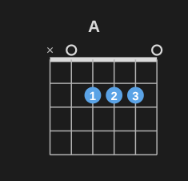
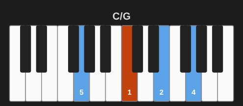
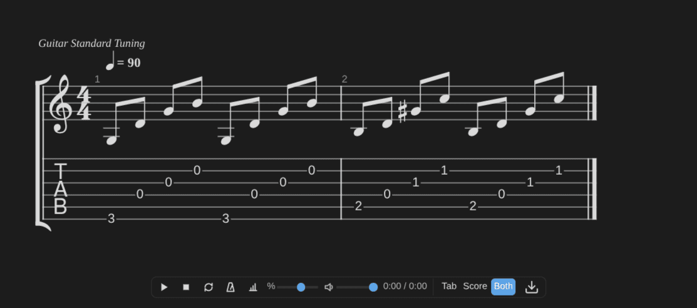

# Notation blocks

Write a chord, a scale, a chord chart, a strumming or fingerpicking pattern or a progression as a small code block, and Music Practice draws it in reading view and live preview. The drawing comes from the [Music Notation](https://github.com/dsebastien/music-notation) library; its [guide](https://dsebastien.github.io/music-notation/blocks.html) lists every option.

## Chord diagrams



````markdown
```chord
A x02220 x01230
```
````

The short form is `symbol frets fingers`, lowest string first: `x` is a muted string, `0` an open one. With keys:

````markdown
```chord
symbol: Bm
frets: x-2-4-4-3-2
fingers: x-1-3-4-2-1
```
````

- A finger on the same fret across several strings draws a barre. The chord's root notes are drawn in a second color.
- With a symbol only (` ```chord ` then `Am`), the diagram uses the most common voicing from the built-in database (about 1,800 voicings); `voicing: 2` picks the next one.
- `name: A` works like `symbol: A`, so chord notes written that way keep working.
- `tuning: DADGAD`, `Drop D` or any notes for other tunings and instruments.

Piano chords, from a symbol or exact pitches, with fingering:



````markdown
```chord
C/G
instrument: piano
fingering: 5-1-2-4
```
````

## Keyboards and fretboards

The notes of a scale, a chord or a list, with note names, degrees or intervals.


````markdown
```keyboard
D dorian
labels: degrees
```
````


````markdown
```fretboard
scale: A minor pentatonic
frets: 5-8
labels: intervals
```
````

## Chord charts

Songs in [ChordPro](https://www.chordpro.org/): chords in brackets inside the lyrics, sections, comments. `{transpose: 2}` moves every chord and the key.


````markdown
```chords
{title: Morning Song}
{key: G}
{capo: 2}

[G]Coffee on the [D/F#]table, [Em]sunlight on the [C]floor

{start_of_chorus}
[C]Play it [G]slow, [D]play it [Em]right
{end_of_chorus}
```
````

Want the chord shapes next to the song? `{diagrams}` draws every chord the song uses as a row above it, in the order they first appear (`{diagrams: bottom}` puts it under). `{define}` gives a chord your own shape, `{chord: Am}` draws one chord where you write it, and `{instrument: piano}` draws piano chords instead. With `{capo: 2}`, guitar diagrams show the shapes you play, with the capo drawn. See the [guide](https://dsebastien.github.io/music-notation/blocks.html#chord-diagrams-in-a-chart).

A chart has a play bar above the song, the same as a [progression](#progressions): each chord above the lyrics plays for one bar, in order, at the song's `{tempo}` and `{time}`. A chord defined with `{define}` plays that shape, and the capo moves the sound. A chord the chart can't read (N.C.) is skipped. The chord that plays lights up in the lyrics.

## Strumming patterns

A ` ```strum ` block draws a strumming pattern on a beat grid: the counts under each slot, an arrow for each strum, accents, muted strums and the chord changes above. Paste it the way you find it on the web: `D - D U - U D U`, `D DU UDU` and `DDUUDU` all work.

````markdown
```strum
[G]D - D U [C]- U D U
title: Old faithful
```
````

- `D>` is an accent, `X` a muted strum (a percussive chuck), `(U)` a ghost strum, and `[G]` a chord change. A line of chords above the pattern works too.
- `time: 3/4` (or `6/8`, `12/8`), `subdivision: 16ths` or `triplets`, `chord: Am` for the whole pattern, `tempo: 100` for playback.
- The bar under the pattern plays it over its chords, with loop, a count-in, tempo and volume, and lights the slot that plays.

Every symbol and option is in the [guide](https://dsebastien.github.io/music-notation/blocks.html#strumming-patterns).

## Picking patterns

A ` ```picking ` block draws a fingerpicking pattern as a small tab: each note's fret on its string, the finger under each slot, and the counts.

````markdown
```picking
pattern: travis
chord: C
```
````

- Write one slot at a time: `p` is the thumb on the bass, `p'` the thumb on the alternate bass (the chord's fifth), and `i`, `m`, `a` the fingers on strings 3, 2 and 1. A string number (`5`, `3`) works too, `p+a` picks two notes together, `-` is a rest and `|` a bar line.
- `pattern: travis`, `pattern: alternate bass` and `pattern: 1-2-3-4` fill a bar for you.
- `chord: Am` for the chord picked, `chords: C Am F G` for one chord a bar, `time: 3/4` (as for strumming patterns), `tempo: 80` for playback.
- The bar under the pattern plays it over its chord or chords, with loop, a count-in, a click (off by default), tempo and volume, and lights the slot that plays.

Every symbol and option is in the [guide](https://dsebastien.github.io/music-notation/blocks.html#picking-patterns).

## Progressions

A ` ```progression ` block writes a progression once and shows its chords in any key, each with its numeral and a diagram. Roman numerals (`I V vi IV`), Nashville numbers (`1 5 6m 4`) or chord names (`G D Em C`) all work.

````markdown
```progression
I V vi IV
key: G
functions: yes
```
````

- `key: G`, `key: Em` or `key: F# minor`. Chord names without a key get the likeliest one, shown with the others it could be.
- `transpose: -2` moves the key, and `functions: yes` writes each chord's function under it (tonic, subdominant, dominant…).
- `---` starts a section in a new key.
- Guitar diagrams use the voicings that make the whole progression easiest to play. `instrument: piano` draws keyboards; add `voice-leading: yes`, or a piano voicing such as `voicing: shell` for a ii-V-I.
- A play bar above the chords plays the progression in time, one chord a bar, with loop, a count-in, a click (on by default), tempo, volume, the strum and the sound. The chord that plays lights up. `time: 3/4` sets the meter, `tempo: 80` the tempo, and `strum:` how each chord plays: `beats` (a strum on each beat, the default), `bar`, `arpeggio` or a strumming pattern (`D - D U - U D U`).
- **Practice this progression in time** plays the note's progressions and chord charts as a backing loop, with the speed trainer, and **Save BPM** offers the tempo you reach as the note's current BPM. See [Usage](usage.md#progressions-in-time).

The numerals, minor keys and Nashville numbers are explained in the [guide](https://dsebastien.github.io/music-notation/blocks.html#progressions), and the play bar in [play a progression in time](https://dsebastien.github.io/music-notation/blocks.html#play-a-progression-in-time).

## Circle of fifths

A ` ```circle ` block draws the circle of fifths: the 12 major keys, their relative minors and the diminished chords, with each key signature around the outside. The key you pick has its chords tinted, with their numerals, and its IV and V stand out.

````markdown
```circle
key: G
```
````

- `key: E minor` or `key: D dorian` for a minor key or a mode, and `chords: sevenths` for seventh chords.
- A click on a key or a chord plays it, and the play button plays the key's scale.

See the [guide](https://dsebastien.github.io/music-notation/blocks.html#circle-of-fifths).

## Several diagrams

Separate diagrams with a line of three dashes to draw them side by side: a song's chords, a progression, the positions of a scale.

````markdown
```chord
G 320003 210003
---
C x32010 x32010
---
D xx0232 xx0132
```
````


Settings shared by every diagram go first, before the first `---` (`orientation`, `hand`, `labels`, and `tuning` or `range`); `columns: 3` draws a grid. A mistake in one diagram doesn't hide the others. Works in `chord`, `keyboard` and `fretboard` blocks; chord charts keep `---` as text. See the library's [guide](https://dsebastien.github.io/music-notation/blocks.html#several-diagrams).

## Orientation and left-handed diagrams

Chord diagrams stand up by default (the nut on top); fretboards and keyboards lie down. `orientation: horizontal` or `orientation: vertical` in a block turns it; `hand: left` mirrors guitar chords and fretboards for left-handed players.


The defaults for every note are settings: **Left-handed**, and the orientation of chord diagrams, fretboards and keyboards (see [Configuration](configuration.md#notation-blocks)). A block's own `orientation` or `hand` wins over them.

## Mistakes

A block with a mistake shows what's wrong and what to write instead. The note itself is never changed.

## Chords and scales, easier

The blocks accept chords in words and recognize chords from their frets, and draw scales and modes more ways (see the library's [guide](https://dsebastien.github.io/music-notation/blocks.html#scales-and-modes)):

- ` ```chord ` with `F Sharp Minor 7`, or only `frets: x02220` (named A).
- Modes mark their characteristic note in a third color; `compare: major` shows what changes from the major scale.
- Fretboards draw one position (`position: 2`, `shape: E`, `shape: 3nps`) or all of them in a row (`positions: all`); `modes: C major` draws every mode of a key.
- ` ```chord ` with `triads: 1-3` draws a chord's triads on a string set (or `key: G major` a key's), with R, 3, 5 in the dots. `from: C x32010` with `to: Am` draws the easiest ways from one chord to the next, with the fingers that stay or slide marked. `progression: G D Em C` draws the smoothest voicings of a progression.
- `capo: 2` on a ` ```chord ` or ` ```fretboard ` block draws a capo. Frets count from it, so an A shape is still `x02220`, and playback plays the notes that sound; `sounds: yes` adds the chord you hear ("Capo 2, sounds B"). See [capo](https://dsebastien.github.io/music-notation/blocks.html#capo).
- `arpeggio: Am7` on a fretboard draws a chord's notes with their intervals; `positions: all` adds its CAGED shapes up the neck. See [arpeggios](https://dsebastien.github.io/music-notation/blocks.html#arpeggios).
- `exercise: up-down` (or `up`, `down`) on a fretboard with one position (`position: 1`, `shape: E`) draws the run of the scale or arpeggio as a tab under the diagram, to play in time. `rhythm:` is `8ths` (the default), `triplets` or `16ths`, and `tempo: 80` sets the tempo. **Insert a tab exercise of this scale or arpeggio** writes the same run as a tab block in a scale or arpeggio note. See [tab exercises](https://dsebastien.github.io/music-notation/blocks.html#tab-exercises) and [Usage](usage.md#tab-exercises).
- Piano chords take `inversion: first`, `voicing: shell` (or `open`, `rootless A`, `rootless B`), `hands: left+right` and `fingering: auto`. See [piano voicings](https://dsebastien.github.io/music-notation/blocks.html#piano-voicings).
- `scales-for: G D Em C` on a fretboard or keyboard draws the scale that fits a song's chords. `scale:` with `chord:` keeps the scale drawn and marks the chord's notes: the notes to aim for when you solo over that chord. See [which scale fits](https://dsebastien.github.io/music-notation/blocks.html#which-scale-fits).
- ` ```chord ` with `voicings: all` (or `voicings: 6`) draws every playable voicing of the chord, the easiest first, each with its name ("Open", "E shape", "Hendrix chord", "Strings 3-6"); `area: 5-9`, `root-string: 5`, `strings: 1-3`, `inversion: any` narrow them down (see the [guide](https://dsebastien.github.io/music-notation/blocks.html#all-the-ways-to-play-a-chord)). The **Voicings of this chord** command does the same for a chord note, and adds the one you pick as its own note.

## Notes draw their own diagram


An empty ` ```chord ` block in a chord note, or an empty ` ```fretboard ` / ` ```keyboard ` block in a scale note, draws what the note's properties say: the chord symbol, frets, fingers and position (guitar), pitches and fingering (piano), or the scale's root, type and shape (a box, CAGED shape or 3NPS) and fingering. The templates already have that empty block, and new notes from **Add a learning note** keep it empty, so a note never repeats its frets or scale in the body. Editing a property redraws the diagram. A block with content draws its content. The property names are settings (Settings → Music Practice → Rules → Property names).

**Identify this chord** names a chord note from its frets or pitches when it has no chord symbol yet. See [Usage](usage.md#add-a-learning-note).

## Hear the diagrams

Hover a chord, keyboard or fretboard diagram (tap it on a phone or tablet) and a bar at its bottom plays it. Chords strum from the low string up and ring. Scales go up and down, from their lowest root to their highest. The bar also has loop, speed (when several notes play), volume and sound (guitar or piano). A click on a dot or a key plays that note.

While a diagram plays, each note lights up when you hear it: the dot, the key or the string's mark. A strummed chord lights its strings from the low one up, and a clicked note lights only what you clicked. Stop, or a new sound, turns every light off. On the first play, the soundfont takes a moment to load: the lights wait for it, so they always match what you hear.

Strumming and picking patterns have their own bar (see [Strumming patterns](#strumming-patterns) and [Picking patterns](#picking-patterns)). Progressions and chord charts have a bar that plays them in time (see [Progressions](#progressions)). The circle of fifths plays a key or a chord when you click it.

The sound comes from a soundfont of recorded instruments, bundled with the plugin, so it works offline. **Settings → Playback** switches to a lighter synthesizer or turns the bar off.

**Play this chord or scale** plays the current chord or scale note.

## Tabs and scores

` ```tab ` and ` ```score ` blocks are written in [alphaTex](https://alphatab.net/docs/alphatex/introduction) and drawn by [alphaTab](https://alphatab.net). alphaTab is bundled with the plugin, so nothing is downloaded and it works offline:

````markdown
```tab
\title "Riff"
\tempo 100
.
:8 0.6 3.6 5.6 0.6 3.6 6.6 5.6 r | 0.6 3.6 5.6 3.6 0.6 r r r
```
````



- `staves: tab | score | both` goes on the first line. By default, `tab` blocks show tablature and `score` blocks show notation.
- The player bar has **Tab**, **Score** and **Both**. The view you see is lit. Select another one to see the music that way: the note doesn't change. To keep it, select **Keep this view**: it writes the `staves:` line at the top of the block (Ctrl+Z, or Cmd+Z, undoes it in editing view). Drums and piano have no tablature, so their blocks have no view buttons.
- `file: [[Song.gp]]` draws a Guitar Pro (3–8), MusicXML or Capella file from your vault instead. `tracks: 1 2` picks the tracks.
- Hover the music (tap it on a phone) for the player: play / pause, stop, loop, metronome, count-in, speed, volume, and **Export** (Guitar Pro 7 or MIDI, saved in your attachments folder, or print in black on white). In a learning note, **Save BPM** opens Set BPM with the tempo the music plays at: its tempo times the speed set on the bar. The sound loads at the first Play. While the music plays, a line follows the beat and the notes that sound light up.
- Tabs work in popout windows too, and when you drag a note to another window.
- A block with a mistake shows an error message. Open **Block text** under it to see what you wrote; the line with the mistake is marked.
- **Insert a tab block** starts one at the cursor, on its own lines. **Insert a tab exercise of this scale or arpeggio** writes the run of a guitar scale or arpeggio note as a tab block (see [Usage](usage.md#tab-exercises)). The [imports](usage.md#imports) turn files and pasted tabs into blocks.
- A ` ```tab ` or ` ```score ` block that holds a plain-text tab (`e|---0---|` lines) shows as tablature, and you can play it. Your note doesn't change: the tab is read again each time the block shows. It shows tablature unless you write a `staves:` line, and keeps its `staves:` and `tracks:` lines. Text tabs have no exact rhythm, so the rhythm comes from the spacing, and the player bar says **Rhythm guessed from the tab**.
- **Text** in the player bar shows the block as you wrote it. **Show as tab** under the text goes back.
- To correct the rhythm or the techniques, select **Edit as alphaTex** (in the player bar, or under the text), or put the cursor in the block and run **Edit this text tab as alphaTex**. The block becomes alphaTex, and your original text tab is kept in a comment at its end. Settings lines at the top (`staves:`, `tracks:`, `file:`) stay as they are, and a block in a list or callout stays in it. To go back, select **Undo** in the notice, or press Ctrl+Z (Cmd+Z) in editing view. On canvas cards, the block shows as tablature, but there is no **Edit as alphaTex** and no **Keep this view**.
- The converter reads string tabs (`e|---0---|`), drum tabs (`HH|x-x-x-x-|`, read as a drum track), strings numbered `1|` to `6|`, and a single named line (`A|--0--3--|`) or a few. A text tab it can't read shows as code. A blank stave, with no note on it, stays text too: it's a template you fill in by hand.

The full syntax, with triads, chord transitions and every option, is in the [library's guide](https://dsebastien.github.io/music-notation/blocks.html).

## Turning blocks off

**Settings → Music Practice → Notation blocks** has one switch per kind of block. A block turned off shows as code. When another plugin already draws one of these code blocks, Music Practice leaves it alone and says so there.

Music Practice claims its blocks once Obsidian has started, so plugins enabled at startup keep theirs. If you enable another plugin later that draws `chord`, `chords`, `keyboard`, `fretboard`, `strum`, `picking`, `progression`, `circle`, `tab` or `score` blocks, it can't register them while Music Practice holds them: turn that block off here, reload Music Practice, then enable the other plugin.

## Obsidian Publish

Obsidian Publish doesn't run plugins. To draw these blocks on a Publish site, add the loader from the [library's Publish guide](https://dsebastien.github.io/music-notation/publish.html) to your site's `publish.js`. Pin the library at 0.8.0 or later (0.11.0 for picking patterns, tab exercises, and progressions and chord charts that play in time), and keep `strum`, `picking`, `progression` and `circle` in the loader's list of block languages: without them, those blocks stay code on your site.

Your layout settings (left-handed, orientations) stay in Obsidian. To get the same on your site, set them at the top of `publish.js`, before the loader:

```js
window.musicNotationOptions = {
    hand: 'left',
    orientation: { chord: 'vertical', fretboard: 'horizontal', keyboard: 'horizontal' }
}
```

Blocks that say `orientation:` or `hand:` look the same everywhere.

Empty blocks in chord, scale, arpeggio, strumming pattern and fingerpicking pattern notes draw from the note's properties on your site too: give the library the page's properties (Obsidian Publish keeps them in its cache).

```js
window.musicNotationOptions = {
    // The page's properties; nothing for embedded notes and hover previews (they aren't this page).
    properties: (el) =>
        el.closest('.markdown-embed, .popover')
            ? null
            : app.site.cache.cache[app.currentFilepath]?.frontmatter
}
```

Pin the library at 0.3.0 or later in the loader: 0.10.1 for arpeggio and strumming pattern notes, 0.11.0 for fingerpicking pattern notes. The library reads the default property names (`chord_symbol`, `frets`, `fingers`, `scale_root`, `picking_pattern`…). If you renamed them in the settings, pass the same names as `propertyNames`.
