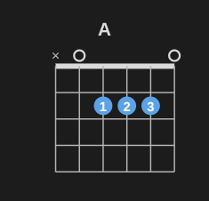
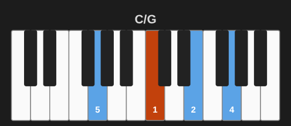
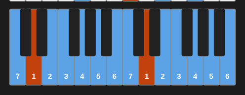
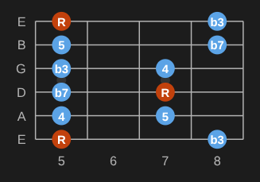
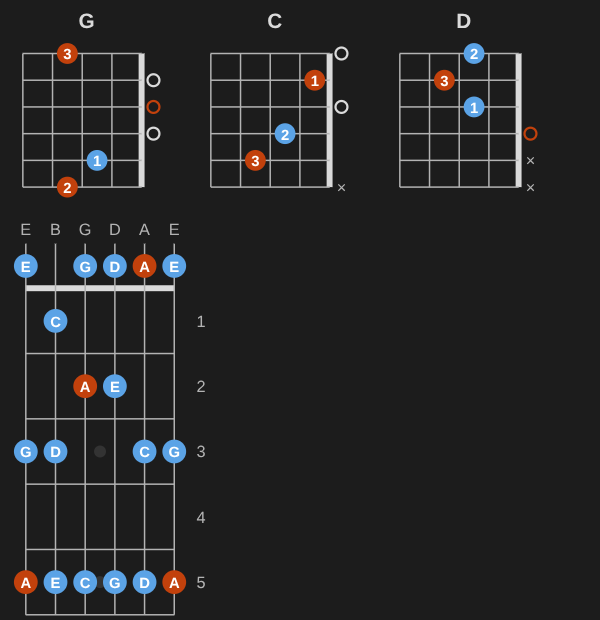
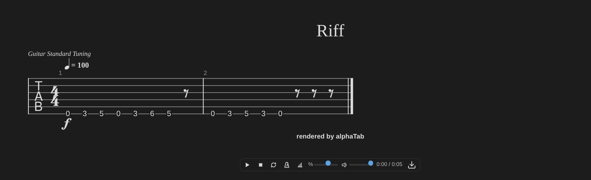

# Notation blocks

Write a chord, a scale or a chord chart as a small code block, and Music Practice draws it in reading view and live preview. The drawing comes from the [Music Notation](https://github.com/dsebastien/music-notation) library; its [guide](https://dsebastien.github.io/music-notation/blocks.html) lists every option.

## Chord diagrams



````markdown
```chord
A x02220 x01230
```
````

The short form is `symbol frets fingers`, lowest string first: `x` is a muted string, `0` an open one. With keys:

````markdown
```chord
symbol: Bm
frets: x-2-4-4-3-2
fingers: x-1-3-4-2-1
```
````

- A finger on the same fret across several strings draws a barre. The chord's root notes are drawn in a second color.
- With a symbol only (` ```chord ` then `Am`), the diagram uses the most common voicing from the built-in database (about 1,800 voicings); `voicing: 2` picks the next one.
- `name: A` works like `symbol: A`, so chord notes written that way keep working.
- `tuning: DADGAD`, `Drop D` or any notes for other tunings and instruments.

Piano chords, from a symbol or exact pitches, with fingering:



````markdown
```chord
C/G
instrument: piano
fingering: 5-1-2-4
```
````

## Keyboards and fretboards

The notes of a scale, a chord or a list, with note names, degrees or intervals.



````markdown
```keyboard
D dorian
labels: degrees
```
````



````markdown
```fretboard
scale: A minor pentatonic
frets: 5-8
labels: intervals
```
````

## Chord charts

Songs in [ChordPro](https://www.chordpro.org/): chords in brackets inside the lyrics, sections, comments. `{transpose: 2}` moves every chord and the key.


````markdown
```chords
{title: Morning Song}
{key: G}
{capo: 2}

[G]Coffee on the [D/F#]table, [Em]sunlight on the [C]floor

{start_of_chorus}
[C]Play it [G]slow, [D]play it [Em]right
{end_of_chorus}
```
````

## Several diagrams

Separate diagrams with a line of three dashes to draw them side by side: a song's chords, a progression, the positions of a scale.

````markdown
```chord
G 320003 210003
---
C x32010 x32010
---
D xx0232 xx0132
```
````


Settings shared by every diagram go first, before the first `---` (`orientation`, `hand`, `labels`, and `tuning` or `range`); `columns: 3` draws a grid. A mistake in one diagram doesn't hide the others. Works in `chord`, `keyboard` and `fretboard` blocks; chord charts keep `---` as text. See the library's [guide](https://dsebastien.github.io/music-notation/blocks.html#several-diagrams).

## Orientation and left-handed diagrams

Chord diagrams stand up by default (the nut on top); fretboards and keyboards lie down. `orientation: horizontal` or `orientation: vertical` in a block turns it; `hand: left` mirrors guitar chords and fretboards for left-handed players.



The defaults for every note are settings: **Left-handed**, and the orientation of chord diagrams, fretboards and keyboards (see [Configuration](configuration.md#notation-blocks)). A block's own `orientation` or `hand` wins over them.

## Mistakes

A block with a mistake shows what's wrong and what to write instead. The note itself is never changed.

## Chords and scales, easier

The blocks accept chords in words and recognize chords from their frets, and draw scales and modes more ways (see the library's [guide](https://dsebastien.github.io/music-notation/blocks.html#scales-and-modes)):

- ` ```chord ` with `F Sharp Minor 7`, or only `frets: x02220` (named A).
- Modes mark their characteristic note in a third color; `compare: major` shows what changes from the major scale.
- Fretboards draw one position (`position: 2`, `shape: E`, `shape: 3nps`) or all of them in a row (`positions: all`); `modes: C major` draws every mode of a key.
- ` ```chord ` with `triads: 1-3` draws a chord's triads on a string set (or `key: G major` a key's), with R, 3, 5 in the dots; `from: C x32010` with `to: Am` the easiest ways from one chord to the next, fingers that stay or slide marked; `progression: G D Em C` the smoothest voicings of a progression.
- ` ```chord ` with `voicings: all` (or `voicings: 6`) draws every playable voicing of the chord, the easiest first; `area: 5-9`, `root-string: 5`, `strings: 1-3`, `inversion: any` narrow them down (see the [guide](https://dsebastien.github.io/music-notation/blocks.html#all-the-ways-to-play-a-chord)). The **Voicings of this chord** command does the same for a chord note, and adds the one you pick as its own note.

## Notes draw their own diagram


An empty ` ```chord ` block in a chord note, or an empty ` ```fretboard ` / ` ```keyboard ` block in a scale note, draws what the note's properties say: the chord symbol, frets, fingers and position (guitar), pitches and fingering (piano), or the scale's root, type and shape (a box, CAGED shape or 3NPS) and fingering. The templates already have that empty block, and new notes from **Add a learning note** keep it empty, so a note never repeats its frets or scale in the body. Editing a property redraws the diagram. A block with content draws its content. The property names are settings (Settings → Music Practice → Rules → Property names).

**Identify this chord** names a chord note from its frets or pitches when it has no chord symbol yet. See [Usage](usage.md#add-a-learning-note).

## Hear the diagrams

Hover a chord, keyboard or fretboard diagram (tap it on a phone or tablet): a bar at its bottom plays it. Chords strum from the low string up and ring; scales go up and down. Loop, speed (when several notes play), volume and sound (guitar or piano) are there too, and a click on a dot or a key plays that note. The sound is a soundfont of recorded instruments, bundled with the plugin, so it works offline; **Settings → Playback** switches to a lighter synthesizer or turns the bar off.

**Play this chord or scale** plays the current chord or scale note.

## Tabs and scores

` ```tab ` and ` ```score ` blocks are written in [alphaTex](https://alphatab.net/docs/alphatex/introduction) and drawn by [alphaTab](https://alphatab.net), bundled with the plugin (offline, nothing downloaded):

````markdown
```tab
\title "Riff"
\tempo 100
.
:8 0.6 3.6 5.6 0.6 3.6 6.6 5.6 r | 0.6 3.6 5.6 3.6 0.6 r r r
```
````



- `staves: tab | score | both` on the first line; `tab` blocks show tablature, `score` blocks notation.
- `file: [[Song.gp]]` draws a Guitar Pro (3–8), MusicXML or Capella file from your vault instead; `tracks: 1 2` picks tracks.
- Hover the music: play / pause, stop, loop, metronome, count-in, speed, volume, and **Export** (Guitar Pro 7 or MIDI, saved in your attachments folder, or print).
- **Insert a tab block** starts one at the cursor; the [imports](usage.md#imports) turn files and pasted tabs into blocks.

The full syntax, with triads, chord transitions and every option, is in the [library's guide](https://dsebastien.github.io/music-notation/blocks.html).

## Turning blocks off

**Settings → Music Practice → Notation blocks** has one switch per kind of block. A block turned off shows as code. When another plugin already draws one of these code blocks, Music Practice leaves it alone and says so there.

Music Practice claims its blocks once Obsidian has started, so plugins enabled at startup keep theirs. If you enable another plugin later that draws `chord`, `chords`, `keyboard`, `fretboard`, `tab` or `score` blocks, it can't register them while Music Practice holds them: turn that block off here, reload Music Practice, then enable the other plugin.

## Obsidian Publish

Obsidian Publish doesn't run plugins. To draw these blocks on a Publish site, add the loader from the [library's Publish guide](https://dsebastien.github.io/music-notation/publish.html) to your site's `publish.js`.

Your layout settings (left-handed, orientations) stay in Obsidian. To get the same on your site, set them at the top of `publish.js`, before the loader:

```js
window.musicNotationOptions = {
    hand: 'left',
    orientation: { chord: 'vertical', fretboard: 'horizontal', keyboard: 'horizontal' }
}
```

Blocks that say `orientation:` or `hand:` look the same everywhere.

Empty blocks in chord and scale notes draw from the note's properties on your site too: give the library the page's properties (Obsidian Publish keeps them in its cache).

```js
window.musicNotationOptions = {
    // The page's properties; nothing for embedded notes and hover previews (they aren't this page).
    properties: (el) =>
        el.closest('.markdown-embed, .popover')
            ? null
            : app.site.cache.cache[app.currentFilepath]?.frontmatter
}
```

Pin the library at 0.3.0 or later in the loader. The library reads the default property names (`chord_symbol`, `frets`, `fingers`, `scale_root`…). If you renamed them in the settings, pass the same names as `propertyNames`.
