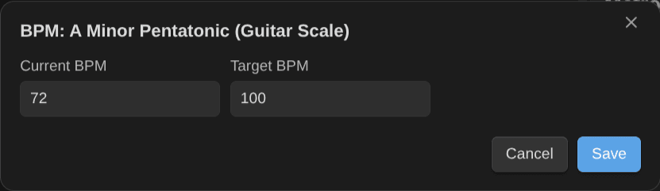

# Tips and troubleshooting

## Tips

- **Pick a current focus.** Give one to three items the top priority: they lead the plan's focus block and show "Current focus".
- **Set a target BPM** on chords, scales, exercises and pieces you want at tempo: practice next weighs the gap, and reaching the target offers "Can play at tempo". **Set BPM of the current note** sets both.

    

- **Link prerequisites** (a song to the chords it uses): what's "ready to learn" and what an item unlocks follow from them.
- **Short sessions count.** A 10-minute plan is still a plan; the practice timer and Log practice take seconds.
- **Use the Kanban Action Planner's timer if you prefer it**: when it runs on your practice activity, Log practice takes it over, so the time is counted once.
- **Forgot to stop the timer?** **Discard practice timer** throws it away without logging anything, after a question that says how long it ran. So do the panel's **Discard** button and a right-click on the timer in the status bar.

## Troubleshooting

| Problem                                         | What to check                                                                                                                                                                                                                                                                                                           |
| ----------------------------------------------- | ----------------------------------------------------------------------------------------------------------------------------------------------------------------------------------------------------------------------------------------------------------------------------------------------------------------------- |
| "No learning notes yet"                         | With the Obsidian Starter Kit: the type needs a status on the mastery scale (10 to 60) and a "last practiced" property. Without it: tag notes `type/music/<instrument>/<kind>` and give them a mastery level (see [Configuration](configuration.md)). **Settings → Note types in use** lists what was found.            |
| An item is missing                              | It needs every tag of its type and its mastery property. Tags are read as a list or as text, any case.                                                                                                                                                                                                                  |
| "Choose which instrument this session is for"   | The items have no instrument (ear training…): pick the session in Log practice, or pass `sessionTypeId` through the API.                                                                                                                                                                                                |
| "A Kanban Action Planner timer is running on …" | That timer times the same activity: tick "Use the … timer" in Log practice, or stop it first.                                                                                                                                                                                                                           |
| No time on the activity                         | The activity is the one whose `session_types` lists the session note type (`guitar-practice-sessions`). When none does (or two do), Log practice asks which one. If the log says Obsidian hadn't indexed the session's link yet, run the Kanban Action Planner's Recompute tracked time on the activity a moment later. |
| "forgotten?" next to the timer                  | The timer started more than 4 hours ago, pauses included. Stop it to log the session, or run **Discard practice timer**. A new timer can't start while it runs.                                                                                                                                                         |
| An item's minutes didn't change                 | They come from its session notes. A value that isn't a number (`"1h"`) or a value above what the sessions give is left as it is, and the notice says so: fix it by hand if the sessions are right.                                                                                                                      |
