# Usage

## Requirements

- Either the [Obsidian Starter Kit](https://store.dsebastien.net/), whose note types define your learning notes and practice sessions, or nothing at all: the standalone note model recognizes learning notes by their tag (`type/music/guitar/chord`) and a mastery level. See [Configuration](configuration.md).
- Optional: the Kanban Action Planner. When it's installed, Music Practice uses its property names for minutes, time entries and review fields, and can take over its running timer.

## Learning notes

A learning note is a note of a type whose status uses the mastery scale (Want to learn, Learning, Can play slowly, Can play at tempo, Rusty, Mastered: only the numbers 10 to 60 matter) and that has a "last practiced" property. With the Obsidian Starter Kit's music types, every guitar or piano chord, scale, technique, exercise and arrangement is one.

Each learning type pairs with a practice session type of the same instrument (`type/music/guitar/chord` pairs with `type/session/music/guitar`).

## Commands

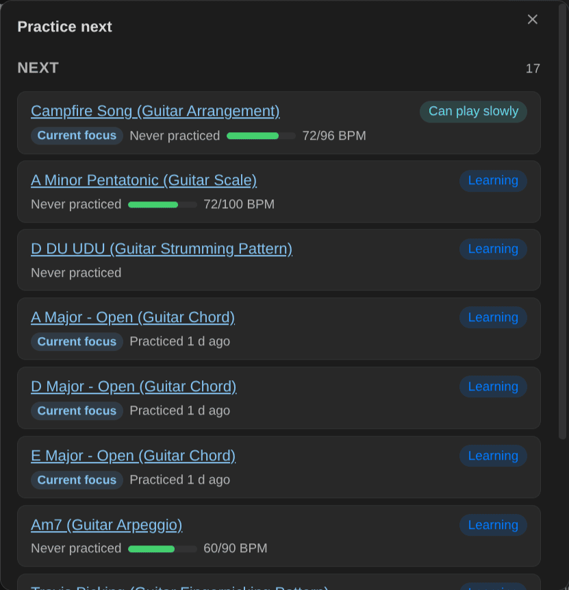

| Command                                                                             | What it does                                                                                                                                                                                                                                                                                                                                                                                                                                                                                                                                                                                                                                                                                                                                                                                                                                                         |
| ----------------------------------------------------------------------------------- | -------------------------------------------------------------------------------------------------------------------------------------------------------------------------------------------------------------------------------------------------------------------------------------------------------------------------------------------------------------------------------------------------------------------------------------------------------------------------------------------------------------------------------------------------------------------------------------------------------------------------------------------------------------------------------------------------------------------------------------------------------------------------------------------------------------------------------------------------------------------- |
| **Practice next**                                                                   | Lists what's due for review, what to practice next (ranked by priority, staleness, BPM gap and what it unlocks) and what's ready to learn.                                                                                                                                                                                                                                                                                                                                                                                                                                                                                                                                                                                                                                                                                                                           |
| **Plan a practice session**                                                         | Splits the minutes you have into warm-up, focus, review and fun, with the items to work on. "Log this session" opens Log practice with them.                                                                                                                                                                                                                                                                                                                                                                                                                                                                                                                                                                                                                                                                                                                         |
| **Add a learning note**                                                             | Creates a chord, scale, technique, exercise or piece in the right type, folder and name. For chords, type the symbol (`F#m7`), the name in words (`F Sharp Minor 7`) or, for guitar, the frets (`x02220`, fingers worked out), or click them on the fretboard under the field; for piano, the keys (`C4 E4 G4`) or click them on the keyboard: the name is spelled out ("F Sharp Minor 7 - Barre"), the symbol becomes an alias, and its root and quality are filled in. **More voicings…** picks from every way to play it. For scales, pick the root and the scale or mode. For arpeggios, type the chord and pick its shape. For strumming patterns, type the pattern (`D DU UDU`), the time signature and the feel. For fingerpicking patterns, type the pattern (Travis, Alternate bass, 1-2-3-4, or the fingers: `p i m a`), the time signature and the chord. |
| **Identify this chord**                                                             | On a chord note with frets (guitar) or pitches (piano) but no chord symbol: names the chord and fills its symbol, root, quality and alias. When the notes can be read several ways, you pick one. When the note has no notes yet, or they make no chord, click them on a fretboard or keyboard: the chord shows as you click, or the chords that hold the notes, with their missing notes.                                                                                                                                                                                                                                                                                                                                                                                                                                                                           |
| **Change mastery of the current note**                                              | The levels, each with what it means for this kind of item.                                                                                                                                                                                                                                                                                                                                                                                                                                                                                                                                                                                                                                                                                                                                                                                                           |
| **Set BPM of the current note**                                                     | Current and target BPM; reaching the target offers "Can play at tempo".                                                                                                                                                                                                                                                                                                                                                                                                                                                                                                                                                                                                                                                                                                                                                                                              |
| **Start practice timer** / **Stop practice timer and log the session**              | The elapsed time shows in the status bar on desktop (click it to stop, right-click it to stop or discard). Stopping opens Log practice with the minutes, the start time and the day the timer started; its **Discard timer** button throws the timer away instead. A timer that started more than 4 hours ago shows as forgotten, in the warning color.                                                                                                                                                                                                                                                                                                                                                                                                                                                                                                              |
| **Log practice**                                                                    | Records a session: minutes, date, an optional focus, the items you practiced, their new mastery, BPM, review results, the session quality and a note.                                                                                                                                                                                                                                                                                                                                                                                                                                                                                                                                                                                                                                                                                                                |
| **Open practice panel**                                                             | The practice panel in the right sidebar (a tab on mobile): the timer, your session list, the metronome. Also the ribbon's music icon. See [Practice panel](#practice-panel).                                                                                                                                                                                                                                                                                                                                                                                                                                                                                                                                                                                                                                                                                         |
| **Pause or resume practice timer**                                                  | Paused time isn't counted as practice.                                                                                                                                                                                                                                                                                                                                                                                                                                                                                                                                                                                                                                                                                                                                                                                                                               |
| **Discard practice timer**                                                          | Throws the running or paused timer away without logging it, after a question that says how long it ran. Use it for a timer you forgot.                                                                                                                                                                                                                                                                                                                                                                                                                                                                                                                                                                                                                                                                                                                               |
| **Start metronome** / **Stop metronome**                                            | In the practice panel when it's open, else in a small window; it keeps playing when you close it (the status bar shows it).                                                                                                                                                                                                                                                                                                                                                                                                                                                                                                                                                                                                                                                                                                                                          |
| **Speed trainer for the current note**                                              | The metronome at the note's current BPM, stepping up toward its target.                                                                                                                                                                                                                                                                                                                                                                                                                                                                                                                                                                                                                                                                                                                                                                                              |
| **Save metronome BPM to its note**                                                  | Opens Set BPM with the tempo you reached.                                                                                                                                                                                                                                                                                                                                                                                                                                                                                                                                                                                                                                                                                                                                                                                                                            |
| **Practice this progression in time**                                               | Plays the note's chords as a backing loop, one a bar or as a chart's bar lines say, with a click, a count-in and the speed trainer, to practice the changes or to solo over them. See [Progressions in time](#progressions-in-time).                                                                                                                                                                                                                                                                                                                                                                                                                                                                                                                                                                                                                                 |
| **Chord change drill** / **Chord change drill for the current note**                | Count the changes between two chords in a minute. See [Chord change drills](#chord-change-drills).                                                                                                                                                                                                                                                                                                                                                                                                                                                                                                                                                                                                                                                                                                                                                                   |
| **Drill notes, chords or scales** / **… for the current note**                      | Find and name notes on the fretboard or the keyboard, name chords and scales, with your weak spots asked most. See [Note, chord and scale drills](#note-chord-and-scale-drills).                                                                                                                                                                                                                                                                                                                                                                                                                                                                                                                                                                                                                                                                                     |
| **Voicings of this chord** / **Voicings of a chord**                                | Every way to play a guitar chord, easiest first. Switch a chord note to another voicing, or add one as its own note. See [All the ways to play a chord](#all-the-ways-to-play-a-chord).                                                                                                                                                                                                                                                                                                                                                                                                                                                                                                                                                                                                                                                                              |
| **Triads of a chord or key** / **Triads of this chord**                             | A chord's triads on a string set, or a key's, with R, 3, 5 in the dots and the metronome at hand. See [Triads](#triads).                                                                                                                                                                                                                                                                                                                                                                                                                                                                                                                                                                                                                                                                                                                                             |
| **Easiest way between these chords**                                                | On a chord pair note (or **Easiest way** in a drill): the next chord's voicings that move the hand least, with tips. See [Chord transitions](#chord-transitions).                                                                                                                                                                                                                                                                                                                                                                                                                                                                                                                                                                                                                                                                                                    |
| **Smooth this progression**                                                         | The voicings that make the chords of the note's chord charts easiest to play in a row.                                                                                                                                                                                                                                                                                                                                                                                                                                                                                                                                                                                                                                                                                                                                                                               |
| **Find the key and scales of this piece**                                           | Reads the note's chord charts and the chord notes it links. Shows its key (or mode), the scales that fit with the notes outside them, and the best scale on a fretboard or keyboard. **Set the key to …** fills the piece's key property. See [Key and scales of a piece](#key-and-scales-of-a-piece).                                                                                                                                                                                                                                                                                                                                                                                                                                                                                                                                                               |
| **Suggest chord change drills from this piece**                                     | Lists the chord changes of the note's charts, hardest first (how much your hand moves, from your own chord notes when you have them), then the most played. **Drill** starts a chord change drill on a change. See [Chord change drills](#chord-change-drills).                                                                                                                                                                                                                                                                                                                                                                                                                                                                                                                                                                                                      |
| **Play this chord or scale**                                                        | Plays the current chord or scale note.                                                                                                                                                                                                                                                                                                                                                                                                                                                                                                                                                                                                                                                                                                                                                                                                                               |
| **Insert a tab block**                                                              | Starts a tab block at the cursor. See [Tabs and scores](notation.md#tabs-and-scores).                                                                                                                                                                                                                                                                                                                                                                                                                                                                                                                                                                                                                                                                                                                                                                                |
| **Insert a tab exercise of this scale or arpeggio**                                 | On a guitar scale or arpeggio note: the run of one position as a tab block that plays in time. See [Tab exercises](#tab-exercises).                                                                                                                                                                                                                                                                                                                                                                                                                                                                                                                                                                                                                                                                                                                                  |
| **Edit this text tab as alphaTex**                                                  | Turns the plain-text tab block at the cursor into alphaTex, to correct its rhythm or techniques: string tabs, drum tabs, strings numbered `1\|` to `6\|`, or a single line. A blank stave stays text. See [Tabs and scores](notation.md#tabs-and-scores).                                                                                                                                                                                                                                                                                                                                                                                                                                                                                                                                                                                                            |
| **Import a score or chord file** / **Import a text tab** / **Import a chord sheet** | Guitar Pro, MusicXML, Capella and ChordPro files; pasted tabs and chord sheets. See [Imports](#imports).                                                                                                                                                                                                                                                                                                                                                                                                                                                                                                                                                                                                                                                                                                                                                             |
| **Undo last practice log**                                                          | Puts the notes back as they were before the last log and trashes its session note. Also the Undo button in the notice after logging.                                                                                                                                                                                                                                                                                                                                                                                                                                                                                                                                                                                                                                                                                                                                 |

## Shortcuts from outside Obsidian

Start practice from a phone shortcut, a Stream Deck button or an NFC tag on your guitar case. Each one opens an Obsidian URI: `obsidian://music-practice?do=<action>`.

| Action          | What it does                                                  |
| --------------- | ------------------------------------------------------------- |
| `start-timer`   | Starts the practice timer.                                    |
| `stop-timer`    | Stops it and opens Log practice with its minutes.             |
| `discard-timer` | Asks, then throws the timer away without logging it.          |
| `log`           | Opens Log practice. `&minutes=30` fills the minutes.          |
| `plan`          | Opens Plan a practice session. `&minutes=45` sets its length. |
| `practice-next` | Opens Practice next.                                          |

With several vaults, put `vault=<name>` first: `obsidian://music-practice?vault=My%20notes&do=start-timer`.

Only starting the timer happens without a window: Obsidian shows a notice and the timer runs. Every other action opens the window you'd use anyway, so nothing is written without you seeing it. A wrong action or parameter shows a notice that says what to write.

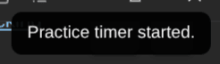

- **iOS Shortcuts**: an Open URL action with `obsidian://music-practice?do=start-timer`.
- **Android**: an Open URL action or an intent with the same URI (Tasker, an NFC tag app).
- **Stream Deck**: a Website action with the URI.

## Practice panel

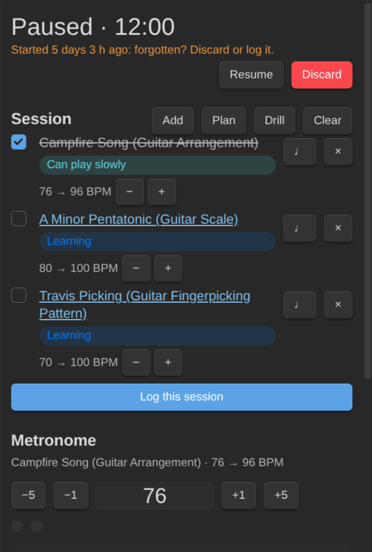

Open it with **Open practice panel** or the ribbon's music icon. It keeps what you practice now in one place:

- **Timer**: start, pause and resume; paused time isn't counted. **Discard** throws the timer away without logging it (it asks first). A timer that started more than 4 hours ago says so: "Started 5 days 3 h ago: forgotten? Discard or log it."
- **Session**: the items you're working on. **Plan** fills it from a practice plan (or use **Use in panel** in Plan a practice session), **Add** finds any item, **Drill** opens a menu: a chord change drill, or a note, chord and scale drill. **Clear** empties the list. Tick items off as you go; −/+ sets the BPM you reached; ♩ gives the item to the metronome; × removes it.
- **Log this session**: Log practice with the ticked items (all of them when none is ticked), their BPMs and the timer's minutes. Logged items leave the list; the rest stay for next time. The list survives restarts.
- **Metronome**: below.

On desktop, the status bar shows the timer too. A click stops it and opens Log practice. A right-click opens a menu with **Stop and log the session** and **Discard the timer**. A forgotten timer shows its age in the warning color: "⏸ 5 days 3 h: forgotten?"

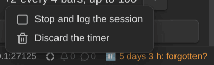

## Metronome

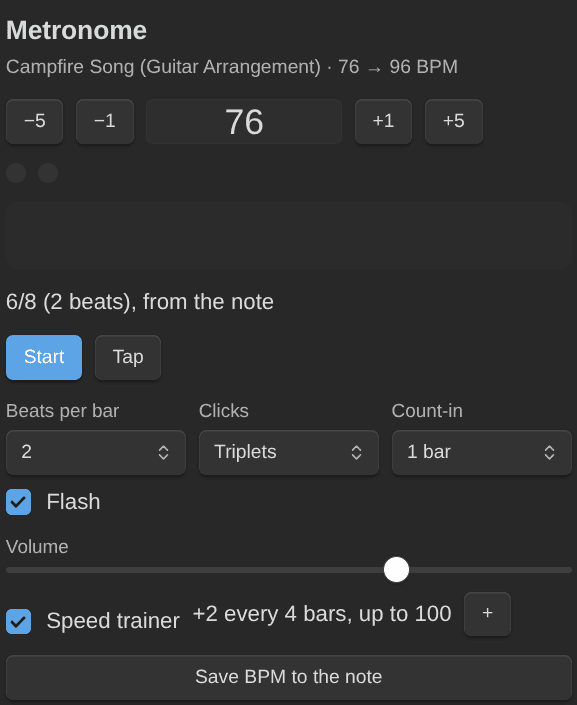

Tempo (type it, −5 −1 +1 +5, or **Tap**), beats per bar with the first accented, clicks per beat (quarter notes, eighths, triplets, sixteenths), volume. **Count-in** (none to 4 bars, 1 by default) clicks a bar of beats before the first bar. The dots go hollow until the music starts, and the speed trainer counts its bars from there. **Flash** lights a bar on each beat, beat one in another color, so you can see the beat in a noisy room. The **speed trainer** starts from the tempo and adds a few BPM every few bars (both in the settings) up to the note's target BPM; **+** steps up at once, after a clean repetition. **Save BPM to the note** opens Set BPM with the tempo reached (reaching the target offers "Can play at tempo").

When the metronome practices a note that has a time signature (`time_signature: 3/4`), it counts that meter: 3/4 is 3 beats, and 6/8 is 2 beats of triplets. It says so: "6/8 (2 beats), from the note". Pick the beats or the clicks by hand to go back to your own.

## Chord change drills

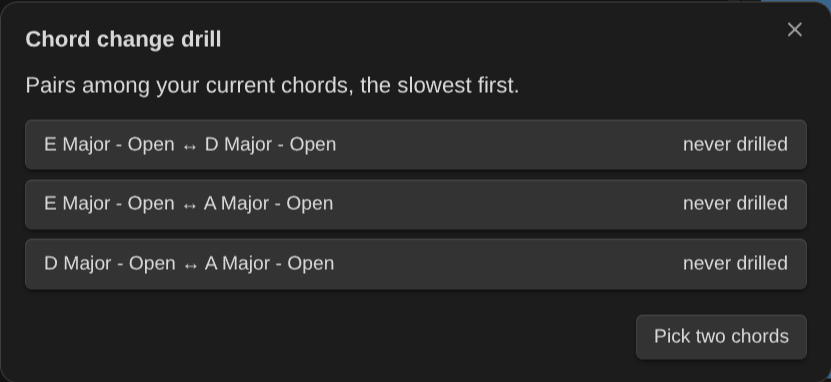

Clean, quick changes between two chords make songs playable. A drill: switch between two chords for a minute and count the changes.

1. Pick a pair: those among your current-focus chords come first, the slowest first (never drilled, then the lowest best). Or **Pick two chords**.
2. **Start** (with the count-in on, it counts 3, 2, 1 first), then press **+1** (or the space bar) at each change. Both chords are drawn side by side.
3. **Save**: the pair's exercise note ("A Major - Open ↔ D Major - Open") keeps the best and the last count (`changes_best`, `changes_last`). The note is created on the first drill and links both chords through `trains`, so it's an exercise like any other: mastery, review, practice next.
4. **Log this drill** logs the minute with the result as the session's note.

The drill's length is a setting (60 seconds by default).

To drill the changes of a song, run **Suggest chord change drills from this piece** on its note. It lists the chord changes of the note's chord charts, hardest first (how much your hand moves, from your own chord notes when you have them), then the most played. **Drill** starts a chord change drill on that change. A change whose chords have no chord note says which one is missing.

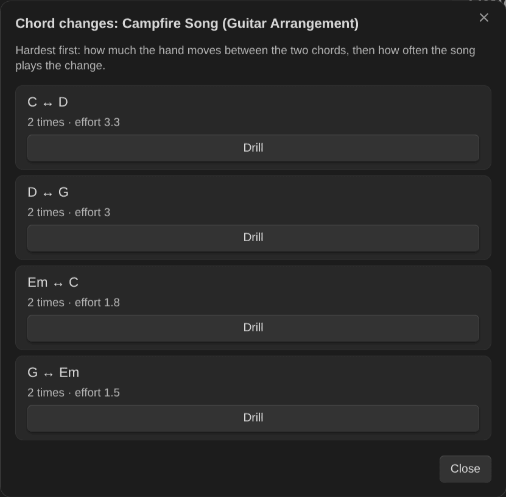

## Note, chord and scale drills

Know the notes on the neck and on the keys, and name chords and scales at a glance. A drill asks 20 questions and remembers where you miss: 6 questions in 10 go to your weak spots.

1. Run **Drill notes, chords or scales** (or **Drill**, then **Notes, chords and scales** in the practice panel). Start one of your drills again, or set a new one:
    - **Fretboard notes**: the strings and the frets ("string 5, frets 0-5"). "Find C on string 5": click it on the neck. "Name the marked note": click its name.
    - **Keyboard notes**: the lowest and highest key ("keys C3-B4"; on a phone a new drill starts on one octave, C4-B4, so the keys are large enough to tap). "Find F#4", or name the marked key.
    - **Chord names**: guitar or piano, a chord family if you want, and where the chords come from: your chord notes (the current focus first), your pieces (chords their charts and progressions play that have no chord note yet), your focus (chords your current-focus notes need and you have no note for), or the library. Name the chord from its diagram, among 4.
    - **Scale shapes**: guitar or piano, from your notes, your focus or the library. Name the scale from its shape, or find its notes on the drawing.
2. Answer. Each click plays its note when playback is on. A right answer is marked with a check; a wrong one with a cross, and the right place is shown. **Next** (or Enter) moves on. A chord or scale that has no note yet gets **Create note**: the note type's template, folder and name, as **Add a learning note** makes it.
3. The score shows your right answers, your time, and the map of your weak spots: each spot with its right answers ("7/9"), colored from orange (missed) to blue (right), a dashed edge on slow ones.
4. **Save**: the drill's note, an exercise note named after the drill ("Fretboard notes, string 5, frets 0-5 (Guitar Exercise)"), keeps the drill's kind and setting (`drill_kind`, `drill_setting`) and the map (`drill_stats`, one item per spot: `s5f3 C: 7/9 1.8s`, plus `, 2 in a row` while a streak runs). Save also records a review: 90 % right or more is good, 60 % shaky, less failed; one a day, so a second drill the same day adds to the map only. The note is created on the first save, at Learning, and private (`public_note: false` when its type has the property): publishing it is your choice.
5. The drill's note joins the practice panel's list. **Log this drill** opens Log practice with it: the time is the practice timer's, as for any practice.

Questions, answers and the map name notes as **Settings → Notation → Note names** says: "Find Do on string 5", "It was La♯.". Your drill notes keep letters, so they work whatever you pick.

A spot stops being weak after 3 right answers in a row, each under 2 seconds. The number of questions, the share of weak spots and both of these numbers are settings. Keyboard drills keep their notes in the piano exercise type, the others in the guitar one, unless you pick piano.

## Key and scales of a piece

**Find the key and scales of this piece** reads the note's chord charts and the chord notes it links in `chords`. It shows the key (or the mode, such as D dorian), and names the next likeliest keys when it isn't clear. It lists the scales that fit, with the notes outside them, and draws the best one on a fretboard (a keyboard for a piano note). **Set the key to …** fills the piece's key property, when its note type has one.

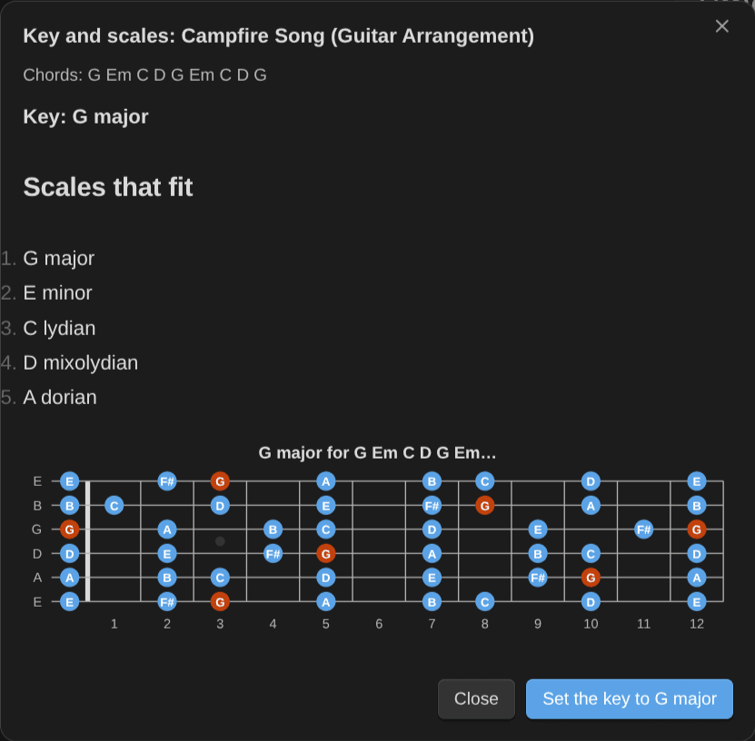

## Progressions in time

Play a song's changes at tempo, or solo over them. **Practice this progression in time** plays the note's chords as a backing loop. It reads, in this order:

- Each ` ```progression ` block, as a progression of its own ("Progression 1", "Progression 2"…), with its `time:`, `tempo:` and `strum:`.
- The note's ` ```chords ` charts, as one progression ("Chord chart"). A line without bar lines plays one chord a bar, repeats included. A line with bar lines plays as they say: dots and slashes give the beats, a `%` or empty bar holds the chord, and a bar of N.C. is a bar of silence (see [Notation](notation.md#bars-in-a-chart)). A chart without `{time}` counts its beats in the note's time signature. `{transpose}` applies, and the first `{time}` and `{tempo}` count. A chord with a `{define}` shape plays that shape, and under `{capo}` the chords sound where the capo puts them.
- The chord notes the note links in its `chords` property, in order ("Linked chord notes").

A note with none of them gets a notice. A progression plays up to 256 bars.

In the window:

- **Progression**: which one to play, when the note has several.
- **Strum**: **A strum on each beat** (the default), **One strum a bar**, **Arpeggio**, the block's own pattern (a progression block's `strum:`), or a strumming pattern note that the note links in its properties.
- **Tempo (BPM)**: from 20 to 240. It starts at the note's current BPM, else the progression's tempo, else 80.
- **Click** (on by default) and **Count-in** (one bar, on when the metronome's count-in is).
- **Speed trainer** (off by default): it adds the metronome's step every few bars (the **Speed trainer step** and **Speed trainer bars** settings), up to the note's target BPM. It counts from the first bar you hear.

The loop counts the progression's own time, else the note's time signature (`time_signature`), else 4/4. 6/8, 9/8 and 12/8 count dotted beats. The window says what it plays: "4 bars of 6/8, one chord a bar, counted in dotted beats. Changes apply from the next pass." For a chart with bar lines, it counts the bars the chords last: "3 bars of 4/4, as the chart's bar lines say".

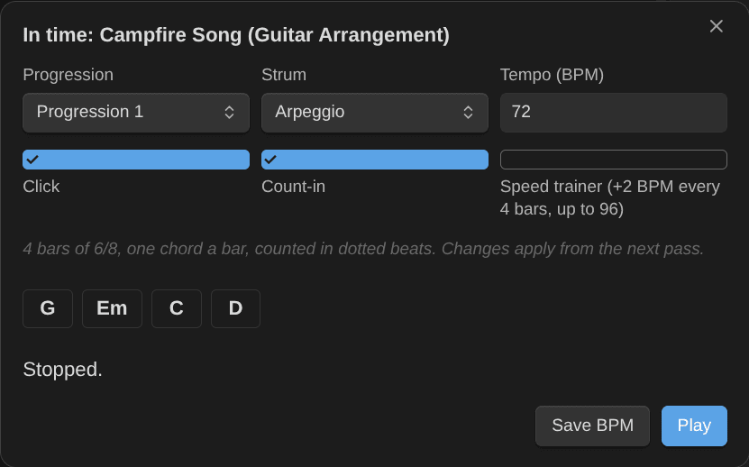

**Play** starts the loop. Each chord is lit while it sounds, for one beat or for several bars, and a bar of silence shows as N.C. The line under the chords shows the bar, the pass and the BPM. A new tempo or click applies from the next pass, and a tempo you type restarts the speed trainer from there. A new progression or strum starts the loop again with it. **Save BPM** (in a learning note) opens Set BPM with the loop's tempo.

The loop plays through your playback settings (the soundfont or the light synthesizer, and the volume), on piano for a piano progression block or a piano note. It never plays with the metronome: starting one stops the other. It stops when you close its window, when you close the Obsidian window it plays in, and when you turn the plugin off.

## Play along with a recording

Learn a song from its recording: loop a passage, slow it down without changing its pitch, jump to the verse or the chorus, and get a count-in before each pass. Put a ` ```playalong ` block in the piece's note with the recording (an audio or a video file of your vault) and its sections (see [Notation](notation.md#play-along-blocks)):

````markdown
```playalong
file: [[Wonderwall.mp3]]
tempo: 87
0:00 Intro
0:12 Verse
0:45.5 Chorus
```
````

The player shows the file, **Play**, the time, a timeline with the loop and the sections on it, and its controls:

- **−** and **+**: the speed, from 50 % to 125 %, in steps of 5 %. The pitch doesn't change.
- **A** and **B** set the start and the end of the loop at the playhead. **Loop** turns it on or off, and the cross clears it. A loop needs half a second at least; set A after B and the two swap. Each pass starts a little before A (the **Pre-roll** setting, 0.2 s by default), so the first note isn't cut.
- **Count-in** (on by default): before Play and before every pass of the loop, the metronome clicks a bar (or its **Count-in** bars) at the recording's tempo times the speed, in the note's time signature. The passage starts on the beat after the last click. The tempo is the recording's: the block's `tempo:` line, else the note's target BPM. Without either, select **Tap** (or press T) on the beat a few times while it plays: two seconds after the last tap, the player writes the tempo as the block's `tempo:` line, so you tap once per song. Tap again to correct it. The note's current BPM is never used: it is the tempo you play at, not the recording's.
- **Add a section** (the bookmark): asks for a name and writes the section at the playhead into the block (Ctrl+Z, or Cmd+Z, undoes it in editing view). The music plays on.
- **Save BPM** (in a learning note): opens Set BPM with the tempo it plays at, the tempo times the speed.
- Under the controls, the sections: select one to jump there, or its loop button to loop it (to the next section, the last one to the end).

Click the player (or press Tab until it is selected) to use the keys: Space or K play and pause, `[` and `]` set A and B, L turns the loop on or off, the arrows go back or forward 5 s (with Shift, 1 s; on the timeline itself, they move a tenth of a second), − and + change the speed, C turns the count-in on or off, T taps the tempo and M adds a section.

Play puts a learning note in the practice panel's list, so **Log this session** logs it with the timer's minutes. Start the timer yourself: Play doesn't. One player plays at a time: Play pauses the others and stops the metronome and the backing loop, and starting either of them pauses the players. The player keeps its loop, speed and tempo while Obsidian runs, also when you switch to editing view or open the note again. A switch to the other view pauses the music: press Play there to go on from the same place. It stops when you close the note, close its window or turn the plugin off. Video files show their picture (click it to play or pause); audio files show only the controls.

## Tab exercises

Learn a scale or an arpeggio position in time, then speed it up. On a guitar scale or arpeggio note, in editing view, run **Insert a tab exercise of this scale or arpeggio**:

- **Position**: a pentatonic's five boxes, then the C, A, G, E and D shapes. Scales of six notes or more get the CAGED shapes, then their 3NPS positions. Arpeggios get the CAGED shapes. The note's own shape is picked first (`Box 3`, `E-shape barre`, `3NPS`).
- **Direction**: **Up and down** (the default), **Up** or **Down**.
- **Rhythm**: **8th notes** (the default), **Triplets** or **16th notes**.
- **Tempo (BPM)**: from 20 to 240. It starts at the note's current BPM, else 60.

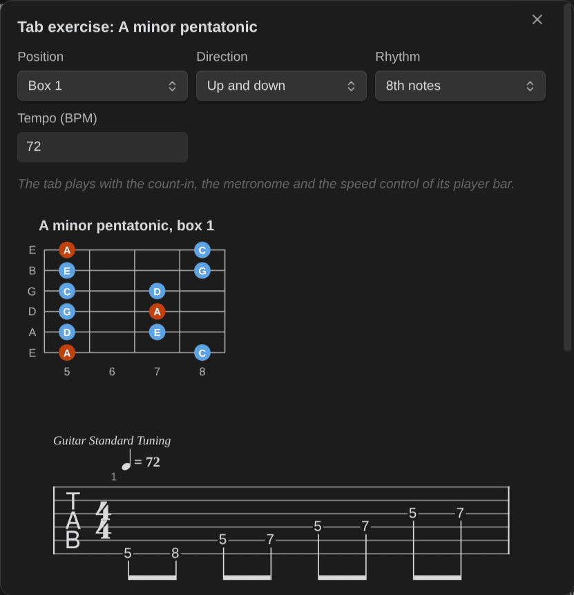

The preview draws the position and its tab. **Insert** puts the run at the cursor as a ` ```tab ` block, the way **Insert a tab block** does: never in the properties or inside another block (it goes after them). The tempo is written in the block once, so a new current BPM doesn't change it.

The tab plays with the count-in, the metronome and the speed of its player bar. In a learning note, every tab and score bar also has **Save BPM** (the gauge icon). It opens Set BPM with the tempo the music plays at: the tab's tempo times the speed set on the bar, rounded. At 125%, a 72 BPM tab saves 90. It reads the speed from the bar, even before the first Play. The play bars of strumming and picking patterns, progressions and chord charts have **Save BPM** too (see [Notation](notation.md#hear-the-diagrams)).

The command is offered on guitar notes whose scale or chord the library reads, when tab blocks are on (**Settings → Music Practice → Notation blocks → Tabs**). Piano notes don't get it: the tab is a guitar's. A ` ```fretboard ` block with `exercise:` draws the same kind of tab under its diagram (see [Notation](notation.md#chords-and-scales-easier)).

## All the ways to play a chord

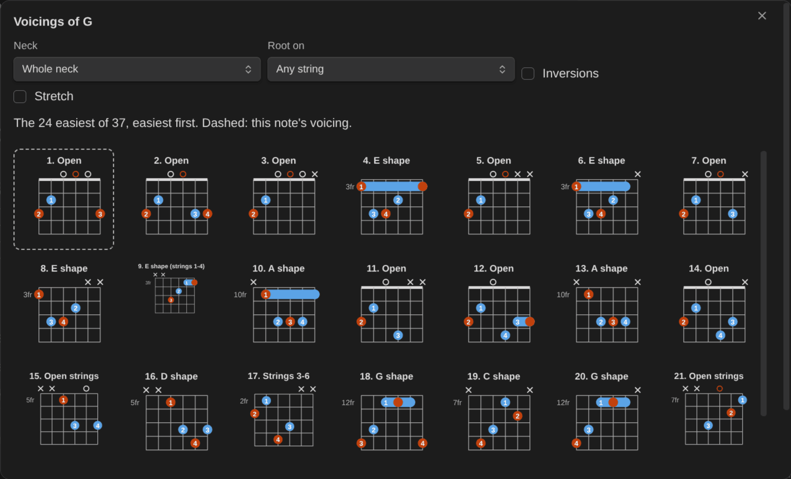

A chord note shows one voicing. **Voicings of this chord** shows every playable one, worked out from the chord's notes, the easiest first: open chords, then E- and A-shape barres and the other CAGED shapes, then the rest. It draws the 24 easiest at most and says how many there are. Each is titled with its shape ("Open", "E shape", "Drop 2", "Hendrix chord", or the strings it sounds, such as "Strings 3-6"). This note's voicing has a dashed border. A long name, such as "E shape (strings 1-4)", wraps onto two lines, and every diagram keeps its neck in line with the others. The other grids of voicings do the same: **Triads of a chord or key**, the voicings of **Add a learning note** and its **More voicings…**, **Easiest way between these chords** and **Smooth this progression**.

- **Neck**: the whole neck, the first position, or frets 1–5, 5–9, 9–12, 12–15.
- **Root on**: any string (the default), or the 6th, 5th or 4th string (with inversions, the string of the lowest note).
- **Inversions**: another chord note in the bass too (the third, the fifth, the seventh). **Stretch**: shapes over five frets.

Pick one, then:

- **Use for this note**: the note gets its frets and fingers (its shape when it had none, and its position if it has one); mastery and history stay with it. Only for another fingering or position of the note's own shape (as the library names its frets), or any voicing when the note has neither frets nor a shape: another shape is another thing to learn, so it gets its own note.
- **Add as note**: a new chord note ("A Major - E-shape barre", or "A Major" when your note type doesn't list its shape), with its frets, fingers and shape, and an empty diagram block that draws them. When that title is taken, the fret is added ("… at fret 5"). When a note already plays that voicing, it opens instead.

**Voicings of a chord** does the same for any chord you type, or whose frets you click on the fretboard under the field. In **Add a learning note**, **More voicings…** picks one for the new note (its shape comes along).

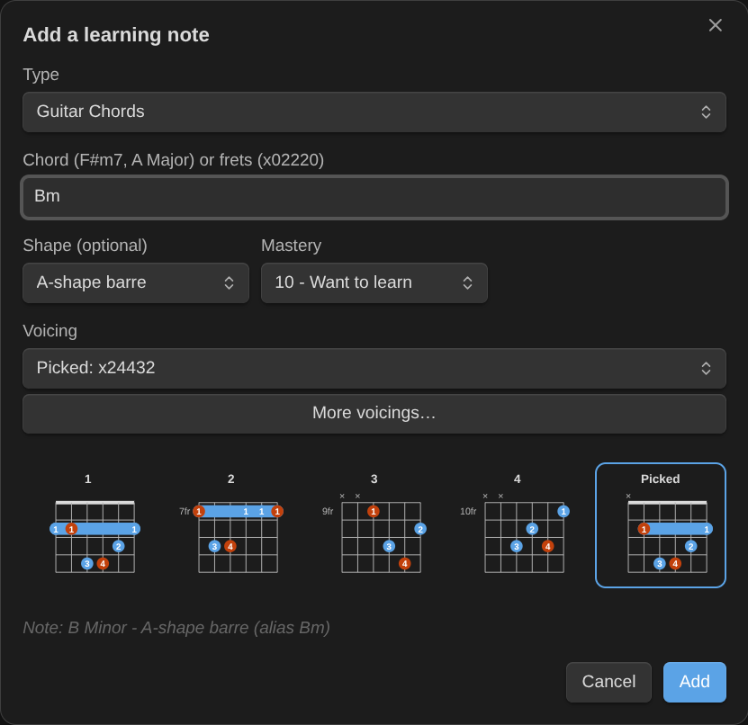

The shapes are matched to your chord note type's shape values (Open, E-shape barre, A-shape barre, CAGED C…); a shape the type doesn't list stays empty.

## Triads

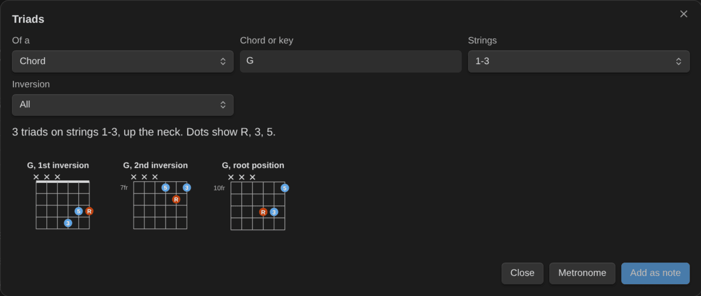

Triads on three strings next to each other, in their three inversions, are how guitarists learn the neck. **Triads of a chord or key** shows a chord's triads on a string set (1-3, 2-4, 3-5, 4-6), up the neck, in all inversions or in one. It also shows a key's seven triads in one inversion. The dots say which chord tone each note is (R, 3, 5), and each diagram plays. **Metronome** opens the metronome to drill them.

**Add as note** makes the triad a chord note of its own, titled "G Major - Triad (strings 1-3, 1st inversion)", with its frets, its fingers and Triad as its shape. An inversion gets its root position as a prerequisite when that note exists, so practice next suggests the root position first. In **Add a learning note**, **Triads…** picks one for the new note (with the same prerequisite).

## Chord transitions

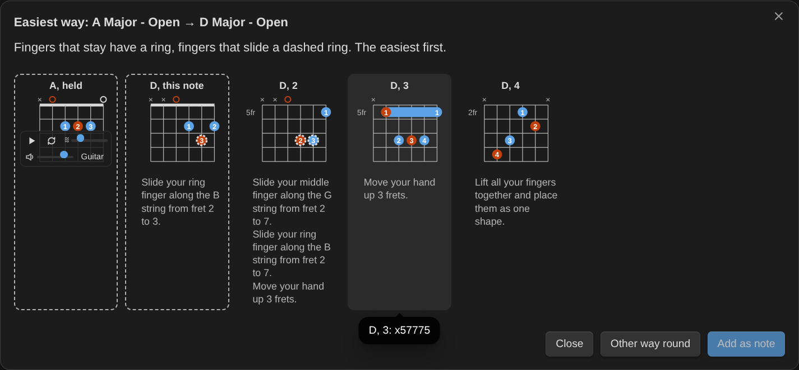

Clean changes come from the right voicing and the fingers that can stay down. **Easiest way between these chords** (on a chord pair note, or **Easiest way** in a chord change drill) shows the chord you hold, then the next chord's voicings that move the hand least:

- Fingers that stay on their fret have a ring. Fingers that slide along their string have a dashed ring.
- Tips in plain words: "Keep your middle finger on the D string's 2nd fret", "Slide your ring finger along the B string from fret 2 to 3".
- **Other way round** switches the direction, and **Add as note** adds a voicing as its own chord note.

**Smooth this progression** reads the chords of the note's chord charts (` ```chords `) in order, transposed when a chart has `{transpose}`. It shows the voicings that make the whole progression easiest, with the moves marked. It says which ones you already have as notes, and adds the missing ones.

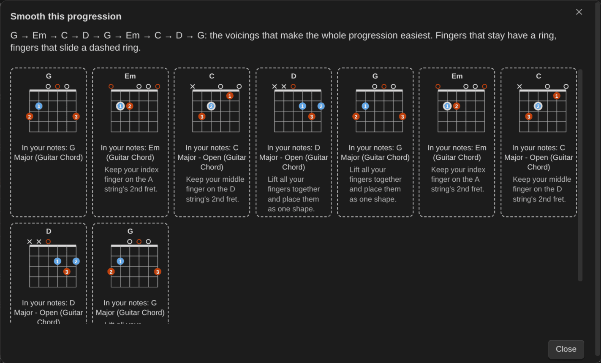

## Imports

- **Import a score or chord file**: a Guitar Pro (3–8), MusicXML or Capella file becomes a tab block, with notation and tablature for guitar files. The block holds either a **link to the file** (the file is copied to your attachments folder and added to the note's `sources`, so nothing is lost) or **inline alphaTex** you can edit. A ChordPro file becomes a chord chart. A chord file with chords over the lyrics (section labels such as `[Verse 1]` included) is converted to one. Older files saved in Windows encodings keep their accents. UTF-16 files are read too, in any script (Cyrillic, Greek, Chinese, Japanese…), with or without a byte order mark (a few hidden bytes at the start of the file). If a file isn't text in any of these encodings, the import stops and a notice says its text can't be read.
- **Import a text tab**: paste a tab from the web (lines of dashes and frets). It becomes a tab block you can play. Drum tabs (`HH|x-x-x-x-|`, as a drum track), strings numbered `1|` to `6|` and a single named line work too. Text tabs have no exact rhythm, so the rhythm comes from the spacing, and a line with no bar lines is split into bars.
- **Import a chord sheet**: paste a sheet with chords over the lyrics. It becomes a chord chart you can transpose.

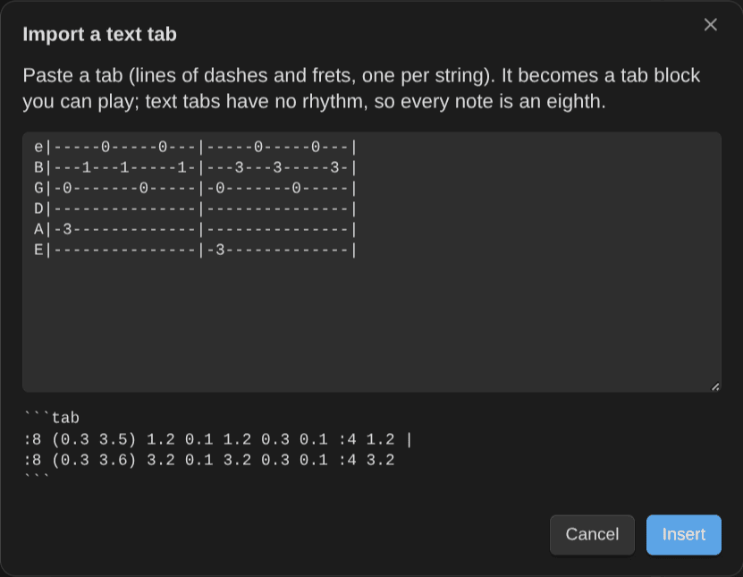

The block goes at the cursor of the note you're editing. If the cursor is in the properties, or in a code, math or HTML block, the new block goes after it. With the cursor in an empty block of the same kind, the import fills that block: an empty tab or score block takes a score or a tab, and an empty chords block takes a chord chart. When you aren't editing a note, the block goes into a new arrangement note. There it fills the first empty block of the same kind (the template's Tab or Chart block), or goes at the end of the note when there is none. If an import fails, that new note and any copied file are removed.

## Undo

The notice after a log has an **Undo** button, and **Undo last practice log** does the same later: the practiced notes and the activity get back what the log changed, and its session note goes to the trash (not when the log used an existing session note again). A Keep or Drop on the activity's minutes is undone with the log. An activity the log created, or the session type it added to an activity's `session_types`, stays. If any of them changed since, nothing is undone and the notice says which. If the log took over a Kanban Action Planner timer, the timer's time entry comes back on the activity. Dates the Obsidian Starter Kit stamps when a level changes (started, mastered) aren't part of the log, so they stay too.

## Log practice

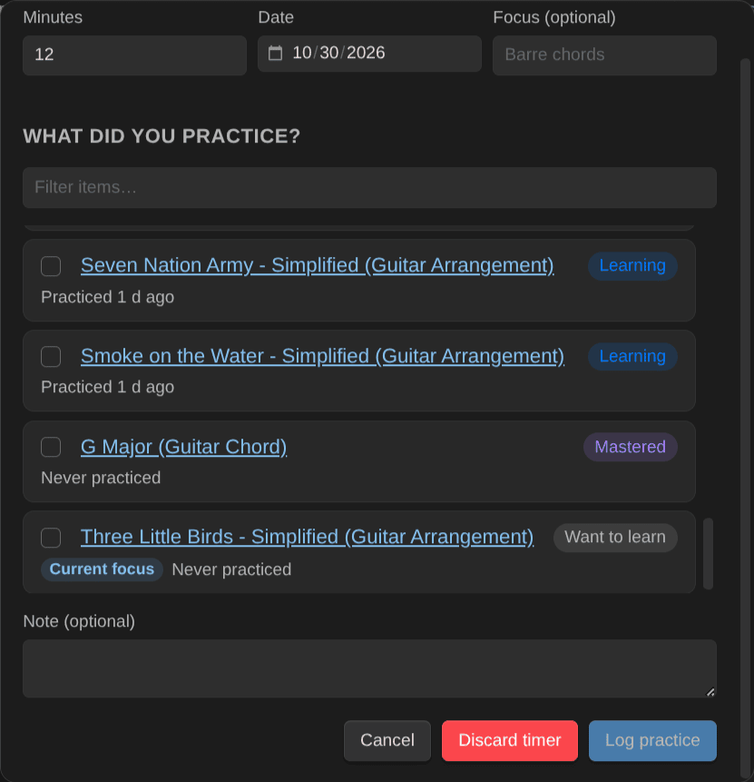

When you stop the timer, Log practice opens with its minutes, its start time and the day it started. Its **Discard timer** button throws the timer away instead, after a question.

1. Enter the minutes, the date and an optional focus ("Barre chords"). When a Kanban Action Planner timer is running on the activity of this session, the log takes it over (tick the box: its minutes fill the Minutes field), so the time is counted once. The timer's own time entry is removed from the activity: the session note holds that time.
2. Tick what you practiced. Items you planned or that are due come first; type to filter. Items of another instrument are dimmed: log them in their own session.
3. For each item, if it applies:
    - change its mastery (the rubric for its kind shows what the level means);
    - enter the BPM you reached (only when the item has a target BPM; reaching it offers "Can play at tempo");
    - rate the review: **Good**, **Shaky** or **Failed**.
4. Pick the session quality and add a note if you want, then **Log practice**.

A session counts for the activity whose `session_types` lists the session note type (for example `guitar-practice-sessions`). One activity per type: a type listed by two activities counts for neither. Archived activities are ignored. Without the Obsidian Starter Kit, and as long as no note uses `session_types`, it is the activity your previous session of that instrument linked to, or the note named by the **Activity name** setting ("Learn Guitar").

When no activity counts this kind of session (or two do), Log practice asks **Counts for the activity** before you can log:

- an existing activity (the closest names come first): the session type is added to its `session_types`, so later sessions count for it too. When other activities list the type, it is removed from theirs (one activity per type), and the dialog names them;
- **New activity…**: a new activity with the name you type ("Learn Guitar" is proposed). It is created only when you select **Log practice**, with the session type in its `session_types` and a `created` date (with the Starter Kit, as one of its activities);
- **No activity**: the session counts for no activity.

What gets written:

- **A session note** first, in the session type's folder, named `<date> <focus>` (or `<date>`, then `<date> 2`… for more sessions that day), with the date, start time, minutes, quality, the practiced items, the minutes each item got (`practiced_minutes`: `"13 [[A Minor]]"`) and the activity.
- **Each item**: last practiced date, BPM, review date, count and interval, new mastery. The first review interval starts when an item reaches "Can play slowly". Its minutes are recomputed from its session notes: its value in `practiced_minutes`, or an even share of the session's minutes for older sessions that only list it.
- **The activity** gets no time entry: the session note links to it and carries the minutes. The activity's minutes and last session date are recomputed from its time entries and its linked session notes.

Minutes are recomputed, never added to, so logging twice never counts twice. If you log the same session again (same items, date, minutes and start time), its session note is used again and a review isn't counted twice. Without a start time from a timer, only a session note that Music Practice created on this device in the last 15 minutes is used again: two real sessions of the same items that day stay two notes. **Undo last practice log** still undoes the first log. Logging it again with other values (mastery, BPM, review) is refused: change them with **Change mastery of the current note** or **Set BPM of the current note**.

Minutes are never lowered on their own. When an item stores more minutes than its sessions give, its minutes stay and a notice says so. When the activity stores more minutes than its time entries and sessions give, a notice asks what to do: **Keep** adds the difference as a "Manual adjustment" time entry that starts at midnight on the day the activity was created (earlier when it would otherwise end in the future). **Drop** lowers the activity's minutes to what its time entries and sessions give.

Everything is checked before anything is written, and one log runs at a time. Minutes that aren't a number (`"1h"`) are never overwritten, and existing time entries are kept as they are (only a taken-over timer's own entry is removed). Instrument-less items (ear training) ask which instrument's session they belong to.

Dates the Obsidian Starter Kit stamps on mastery changes (started, mastered) are left to it.

## Add a learning note

### Click the notes

You don't need to know how to write frets. Under the chord field, **Add a learning note** shows a fretboard for guitar chords and a keyboard for piano chords. On the fretboard, click a string at a fret to play it there; click it again to mute the string; click before the nut (fret 0) for an open string. On the keyboard, click the keys of the chord, and click a key again to take it away. The field fills in as you click (`x32010`, `C4 E4 G4`), each click sounds its note when **Settings → Playback** is on, and you can still type in the field: the drawing follows. With the keyboard of your computer, Tab goes to the drawing, the arrows move, and Space or Enter clicks.

When the notes make no chord the library knows, the chords that hold them show under the drawing, with the notes they miss: "C (missing G)". The same notes show once (Dm7, not also F6). Point at one, or focus it, to see its missing notes as dashed rings on the drawing; click it to use that chord. **Voicings of a chord** works the same way. **Identify this chord** shows the near matches and their missing notes too, but only names the note with a chord its notes make: add the missing notes, then pick the chord.

For piano, one name is a chord first: type `G7` for the chord, and keys with two names or more (`G3 B3 D4 F4`). Flats stay as you type them; keys you click are spelled as their chord spells them (`Bb3 D4 F4`). A click on a chosen note takes it away and still sounds it. The drawings show frets 0 to 12 and the keys from C3 to B4: notes outside them stay in the field but have no dot. The sound follows the playback settings in effect when the window opens.

Pick the type (Guitar Chords, Piano Scales…), type a name (for chords: a symbol, a name in words, or guitar frets), and optionally the shape and the starting level. The note is created from the type's template (its prompts are skipped: the dialog already asked), in the type's folder, with the type's name suffix.

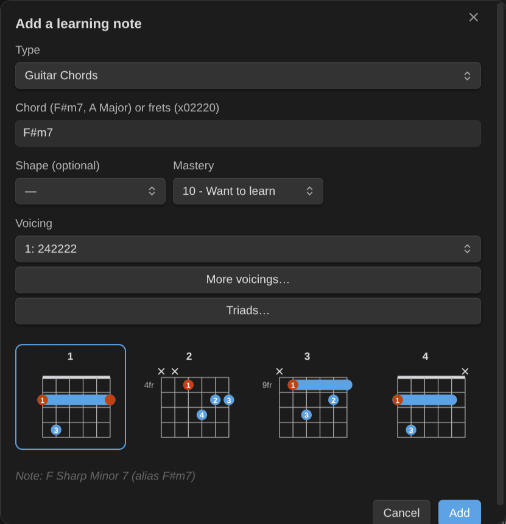

For guitar chords, the four most common **voicings** are drawn side by side: click one to pick it, or choose any voicing (or "No diagram") from the dropdown. Typed frets are named by the library and stored in compact form (`x02220`), without fingers. The previews follow your orientation and left-handed settings.

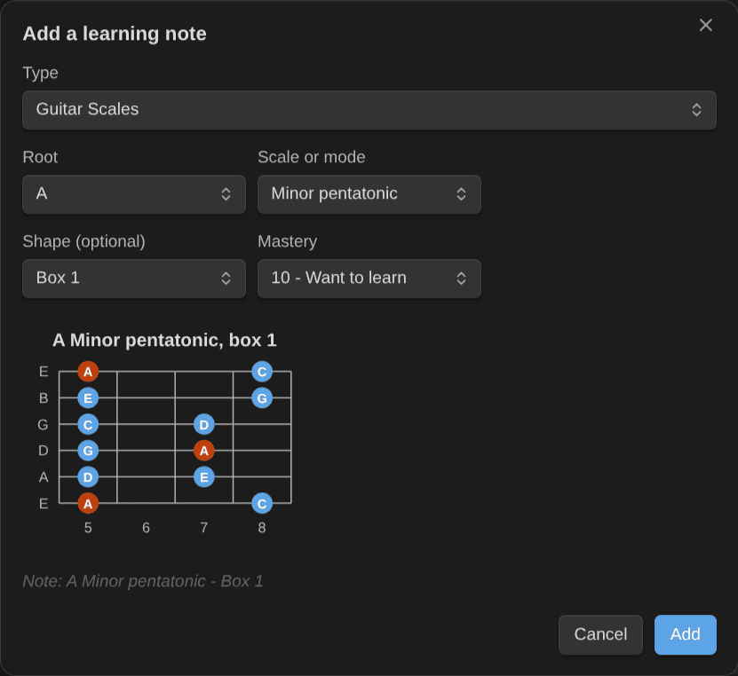

For scales, pick the **root** and the **scale or mode** (the type's own values, or the common ones), and for guitar the **shape** (a box, a CAGED shape or 3NPS). The preview shows the scale as the note will.

New chord and scale notes get their properties (`chord_symbol`, `frets`, `fingers`; `scale_root`, `scale_type`, `shape`) and an empty ` ```chord `, ` ```fretboard ` or ` ```keyboard ` block, the template's when it has one. That block draws from the properties: nothing is written twice, and editing a property updates the diagram. Nothing is added when that kind of block is turned off. See [Notation](notation.md#notes-draw-their-own-diagram).

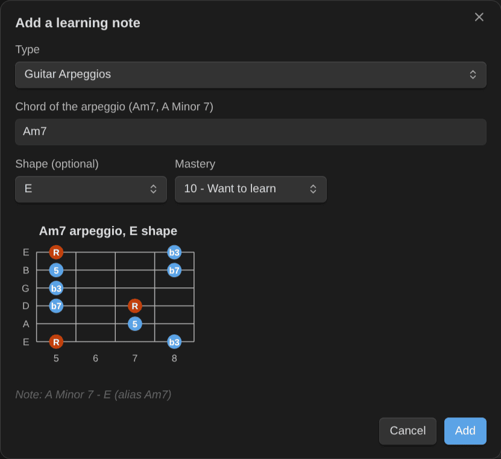

Arpeggio notes get the chord symbol and the shape, and an empty ` ```fretboard ` block (` ```keyboard ` on piano) that draws the arpeggio in that CAGED shape. A guitar chord note's empty fretboard block draws its chord's arpeggio too.

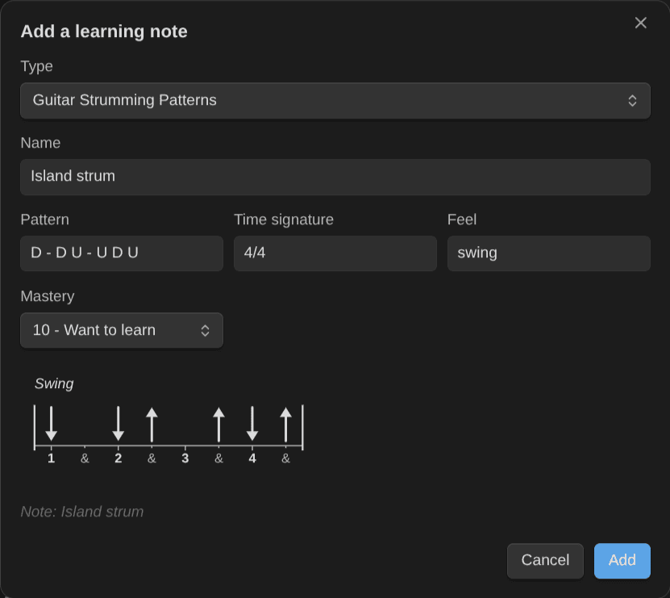

Strumming pattern notes get `strum_pattern`, `time_signature` and `strum_feel`, and an empty ` ```strum ` block that plays the pattern at the note's current BPM, swung when the feel says so.

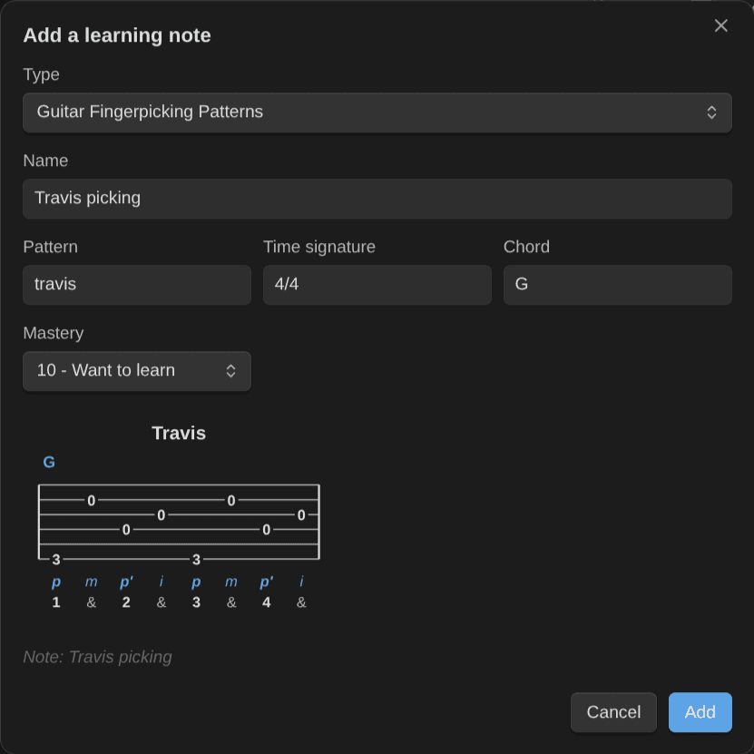

For fingerpicking patterns, type the pattern (pick **Travis**, **Alternate bass** or **1-2-3-4**, or write the fingers: `p i m a p' i m a`), the time signature and the chord. A type is a fingerpicking pattern type when it has the picking pattern property and not the strumming one. The note gets `picking_pattern`, `time_signature` and `chord_symbol` (the chord as the library spells it: `A Minor` becomes `Am`), and an empty ` ```picking ` block that plays the pattern over its chord at the note's current BPM. The preview shows that block. Nothing is added when picking blocks are turned off.

Arpeggio, strumming pattern and fingerpicking pattern notes draw on Obsidian Publish too: see [Notation](notation.md#obsidian-publish).
