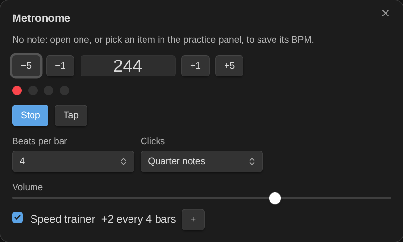
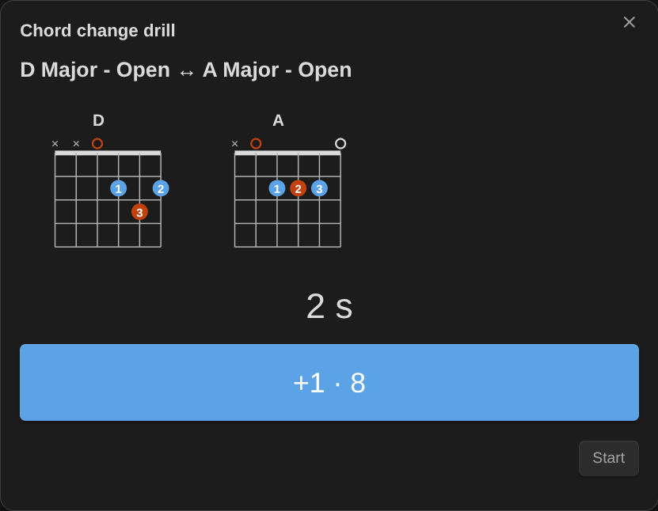
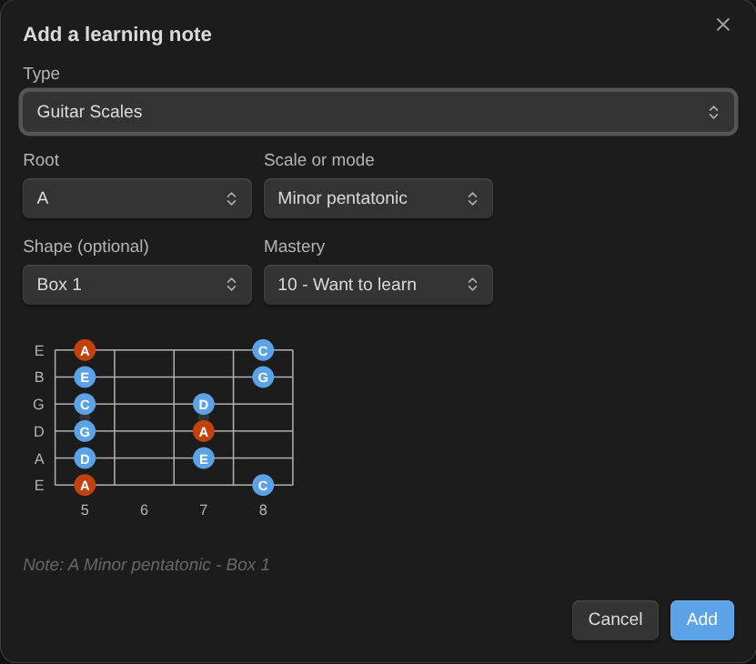

# Usage

## Requirements

- Either the [Obsidian Starter Kit](https://store.dsebastien.net/), whose note types define your learning notes and practice sessions, or nothing at all: the standalone note model recognizes learning notes by their tag (`type/music/guitar/chord`) and a mastery level. See [Configuration](configuration.md).
- Optional: the Kanban Action Planner. When it's installed, Music Practice writes time entries and review fields with the same property names, and can take over its running timer.

## Learning notes

A learning note is a note of a type whose status uses the mastery scale (Want to learn, Learning, Can play slowly, Can play at tempo, Rusty, Mastered: only the numbers 10 to 60 matter) and that has a "last practiced" property. With the Obsidian Starter Kit's music types, every guitar or piano chord, scale, technique, exercise and arrangement is one.

Each learning type pairs with a practice session type of the same instrument (`type/music/guitar/chord` pairs with `type/session/music/guitar`).

## Commands


| Command                                                                | What it does                                                                                                                                                                                                                                                                                                                                                                          |
| ---------------------------------------------------------------------- | ------------------------------------------------------------------------------------------------------------------------------------------------------------------------------------------------------------------------------------------------------------------------------------------------------------------------------------------------------------------------------------- |
| **Practice next**                                                      | Lists what's due for review, what to practice next (ranked by priority, staleness, BPM gap and what it unlocks) and what's ready to learn.                                                                                                                                                                                                                                            |
| **Plan a practice session**                                            | Splits the minutes you have into warm-up, focus, review and fun, with the items to work on. "Log this session" opens Log practice with them.                                                                                                                                                                                                                                          |
| **Add a learning note**                                                | Creates a chord, scale, technique, exercise or piece in the right type, folder and name. For chords, type the symbol (`F#m7`), the name in words (`F Sharp Minor 7`) or, for guitar, the frets (`x02220`): the name is spelled out ("F Sharp Minor 7 - Barre"), the symbol becomes an alias, and its root and quality are filled in. For scales, pick the root and the scale or mode. |
| **Identify this chord**                                                | On a chord note with frets (guitar) or pitches (piano) but no chord symbol: names the chord and fills its symbol, root, quality and alias. When the notes can be read several ways, you pick one.                                                                                                                                                                                     |
| **Change mastery of the current note**                                 | The levels, each with what it means for this kind of item.                                                                                                                                                                                                                                                                                                                            |
| **Set BPM of the current note**                                        | Current and target BPM; reaching the target offers "Can play at tempo".                                                                                                                                                                                                                                                                                                               |
| **Start practice timer** / **Stop practice timer and log the session** | The elapsed time shows in the status bar on desktop (click it to stop). Stopping opens Log practice with the minutes, the start time and the day the timer started.                                                                                                                                                                                                                   |
| **Log practice**                                                       | Records a session: minutes, date, an optional focus, the items you practiced, their new mastery, BPM, review results, the session quality and a note.                                                                                                                                                                                                                                 |
| **Open practice panel**                                                | The practice panel in the right sidebar (a tab on mobile): the timer, your session list, the metronome. Also the ribbon's music icon. See [Practice panel](#practice-panel).                                                                                                                                                                                                          |
| **Pause or resume practice timer**                                     | Paused time isn't counted as practice.                                                                                                                                                                                                                                                                                                                                                |
| **Start metronome** / **Stop metronome**                               | In the practice panel when it's open, else in a small window; it keeps playing when you close it (the status bar shows it).                                                                                                                                                                                                                                                           |
| **Speed trainer for the current note**                                 | The metronome at the note's current BPM, stepping up toward its target.                                                                                                                                                                                                                                                                                                               |
| **Save metronome BPM to its note**                                     | Opens Set BPM with the tempo you reached.                                                                                                                                                                                                                                                                                                                                             |
| **Chord change drill** / **Chord change drill for the current note**   | Count the changes between two chords in a minute. See [Chord change drills](#chord-change-drills).                                                                                                                                                                                                                                                                                    |
| **Undo last practice log**                                             | Puts the notes back as they were before the last log and trashes its session note. Also the Undo button in the notice after logging.                                                                                                                                                                                                                                                  |

## Practice panel


Open it with **Open practice panel** or the ribbon's music icon. It keeps what you practice now in one place:

- **Timer**: start, pause and resume; paused time isn't counted.
- **Session**: the items you're working on. **Plan** fills it from a practice plan (or use **Use in panel** in Plan a practice session), **Add** finds any item. Tick items off as you go; −/+ sets the BPM you reached; ♩ gives the item to the metronome; × removes it.
- **Log this session**: Log practice with the ticked items (all of them when none is ticked), their BPMs and the timer's minutes. Logged items leave the list; the rest stay for next time. The list survives restarts.
- **Drill**: a chord change drill.
- **Metronome**: below.

## Metronome



Tempo (type it, −5 −1 +1 +5, or **Tap**), beats per bar with the first accented, clicks per beat (quarter notes, eighths, triplets, sixteenths), volume. The **speed trainer** starts from the tempo and adds a few BPM every few bars (both in the settings) up to the note's target BPM; **+** steps up at once, after a clean repetition. **Save BPM to the note** opens Set BPM with the tempo reached (reaching the target offers "Can play at tempo").

## Chord change drills



Clean, quick changes between two chords make songs playable. A drill: switch between two chords for a minute and count the changes.

1. Pick a pair: those among your current-focus chords come first, the slowest first (never drilled, then the lowest best). Or **Pick two chords**.
2. **Start**, then press **+1** (or the space bar) at each change. Both chords are drawn side by side.
3. **Save**: the pair's exercise note ("A Major - Open ↔ D Major - Open") keeps the best and the last count (`changes_best`, `changes_last`). The note is created on the first drill and links both chords through `trains`, so it's an exercise like any other: mastery, review, practice next.
4. **Log this drill** logs the minute with the result as the session's note.

The drill's length is a setting (60 seconds by default).

## Undo

The notice after a log has an **Undo** button, and **Undo last practice log** does the same later: the practiced notes and the activity get back what the log changed, and its session note goes to the trash. If any of them changed since, nothing is undone and the notice says which. A Kanban Action Planner timer's own time entry stays (it's real time). Dates the Obsidian Starter Kit stamps when a level changes (started, mastered) aren't part of the log, so they stay too.

## Log practice


1. Enter the minutes, the date and an optional focus ("Barre chords"). When a Kanban Action Planner timer is running on the activity of this session, the log takes it over (tick the box: its minutes fill the Minutes field), so the time is counted once.
2. Tick what you practiced. Items you planned or that are due come first; type to filter. Items of another instrument are dimmed: log them in their own session.
3. For each item, if it applies:
    - change its mastery (the rubric for its kind shows what the level means);
    - enter the BPM you reached (only when the item has a target BPM; reaching it offers "Can play at tempo");
    - rate the review: **Good**, **Shaky** or **Failed**.
4. Pick the session quality and add a note if you want, then **Log practice**.

What gets written:

- **Each item**: last practiced date, minutes (the session split evenly), BPM, review date, count and interval, new mastery. The first review interval starts when an item reaches "Can play slowly".
- **A session note** in the session type's folder, named `<date> <focus>` (or `<date>`, then `<date> 2`… for more sessions that day), with the date, start time, minutes, quality, the practiced items and the activity.
- **The activity** the session counts towards (the one your previous session of that instrument linked to, or a note named "Learn Guitar"): one time entry per session, its minutes and its last session date. An activity never gets two entries for the same session.

Everything is checked before anything is written, and one log runs at a time. Minutes are never added to a value that isn't a number, and existing time entries are kept as they are. Instrument-less items (ear training) ask which instrument's session they belong to.

Dates the Obsidian Starter Kit stamps on mastery changes (started, mastered) are left to it.

## Add a learning note


Pick the type (Guitar Chords, Piano Scales…), type a name (for chords: a symbol, a name in words, or guitar frets), and optionally the shape and the starting level. The note is created from the type's template (its prompts are skipped: the dialog already asked), in the type's folder, with the type's name suffix.


For guitar chords, the four most common **voicings** are drawn side by side: click one to pick it, or choose any voicing (or "No diagram") from the dropdown. Typed frets are named by the library and stored in compact form (`x02220`), without fingers. The previews follow your orientation and left-handed settings.



For scales, pick the **root** and the **scale or mode** (the type's own values, or the common ones), and for guitar the **shape** (a box, a CAGED shape or 3NPS). The preview shows the scale as the note will.

New chord and scale notes get their properties (`chord_symbol`, `frets`, `fingers`; `scale_root`, `scale_type`, `shape`) and an empty ` ```chord `, ` ```fretboard ` or ` ```keyboard ` block, the template's when it has one. That block draws from the properties: nothing is written twice, and editing a property updates the diagram. Nothing is added when that kind of block is turned off. See [Notation](notation.md#notes-draw-their-own-diagram).
