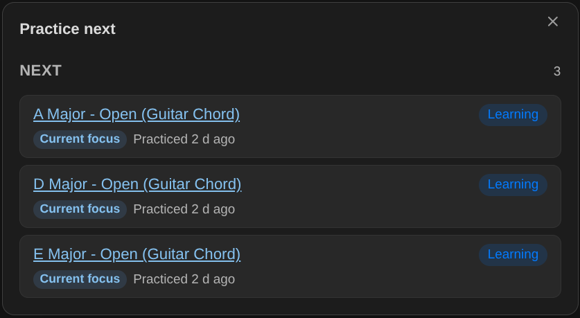
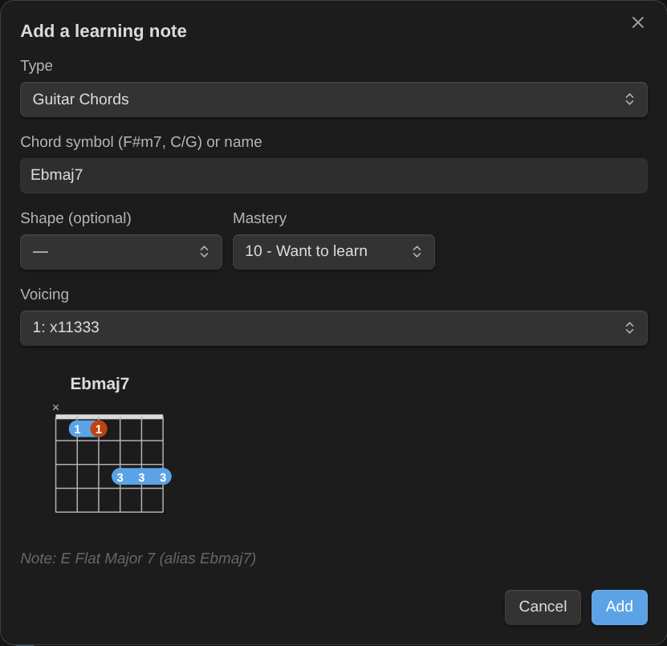

# Usage

## Requirements

- Either the [Obsidian Starter Kit](https://store.dsebastien.net/), whose note types define your learning notes and practice sessions, or nothing at all: the standalone note model recognizes learning notes by their tag (`type/music/guitar/chord`) and a mastery level. See [Configuration](configuration.md).
- Optional: the Kanban Action Planner. When it's installed, Music Practice writes time entries and review fields with the same property names, and can take over its running timer.

## Learning notes

A learning note is a note of a type whose status uses the mastery scale (Want to learn, Learning, Can play slowly, Can play at tempo, Rusty, Mastered: only the numbers 10 to 60 matter) and that has a "last practiced" property. With the Obsidian Starter Kit's music types, every guitar or piano chord, scale, technique, exercise and arrangement is one.

Each learning type pairs with a practice session type of the same instrument (`type/music/guitar/chord` pairs with `type/session/music/guitar`).

## Commands



| Command                                                                | What it does                                                                                                                                                                                                                                                    |
| ---------------------------------------------------------------------- | --------------------------------------------------------------------------------------------------------------------------------------------------------------------------------------------------------------------------------------------------------------- |
| **Practice next**                                                      | Lists what's due for review, what to practice next (ranked by priority, staleness, BPM gap and what it unlocks) and what's ready to learn.                                                                                                                      |
| **Plan a practice session**                                            | Splits the minutes you have into warm-up, focus, review and fun, with the items to work on. "Log this session" opens Log practice with them.                                                                                                                    |
| **Add a learning note**                                                | Creates a chord, scale, technique, exercise or piece in the right type, folder and name. For chords, type the symbol (`F#m7`, `C/G`): the name is spelled out ("F Sharp Minor 7 - Barre"), the symbol becomes an alias, and its root and quality are filled in. |
| **Change mastery of the current note**                                 | The levels, each with what it means for this kind of item.                                                                                                                                                                                                      |
| **Set BPM of the current note**                                        | Current and target BPM; reaching the target offers "Can play at tempo".                                                                                                                                                                                         |
| **Start practice timer** / **Stop practice timer and log the session** | The elapsed time shows in the status bar on desktop (click it to stop). Stopping opens Log practice with the minutes, the start time and the day the timer started.                                                                                             |
| **Log practice**                                                       | Records a session: minutes, date, an optional focus, the items you practiced, their new mastery, BPM, review results, the session quality and a note.                                                                                                           |

## Log practice


1. Enter the minutes, the date and an optional focus ("Barre chords"). When a Kanban Action Planner timer is running on the activity of this session, the log takes it over (tick the box: its minutes fill the Minutes field), so the time is counted once.
2. Tick what you practiced. Items you planned or that are due come first; type to filter. Items of another instrument are dimmed: log them in their own session.
3. For each item, if it applies:
    - change its mastery (the rubric for its kind shows what the level means);
    - enter the BPM you reached (only when the item has a target BPM; reaching it offers "Can play at tempo");
    - rate the review: **Good**, **Shaky** or **Failed**.
4. Pick the session quality and add a note if you want, then **Log practice**.

What gets written:

- **Each item**: last practiced date, minutes (the session split evenly), BPM, review date, count and interval, new mastery. The first review interval starts when an item reaches "Can play slowly".
- **A session note** in the session type's folder, named `<date> <focus>` (or `<date>`, then `<date> 2`… for more sessions that day), with the date, start time, minutes, quality, the practiced items and the activity.
- **The activity** the session counts towards (the one your previous session of that instrument linked to, or a note named "Learn Guitar"): one time entry per session, its minutes and its last session date. An activity never gets two entries for the same session.

Everything is checked before anything is written, and one log runs at a time. Minutes are never added to a value that isn't a number, and existing time entries are kept as they are. Instrument-less items (ear training) ask which instrument's session they belong to.

Dates the Obsidian Starter Kit stamps on mastery changes (started, mastered) are left to it.

## Add a learning note


Pick the type (Guitar Chords, Piano Scales…), type a name, or a chord symbol for chord types, and optionally the shape and the starting level. The note is created from the type's template (its prompts are skipped: the dialog already asked), in the type's folder, with the type's name suffix.



For guitar chords, pick a **voicing** among those found for the symbol (the preview shows it, or choose "No diagram"): the note gets its `frets` and `fingers` and a ` ```chord ` block, in the template's empty chord block when it has one. Piano chords get a keyboard block. See [Notation](notation.md).
